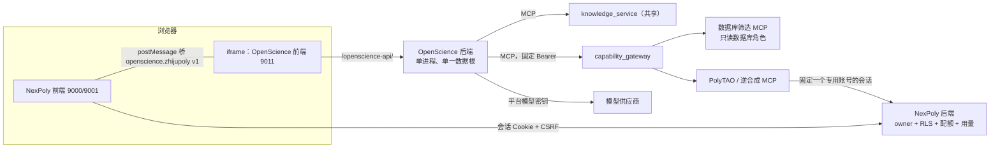
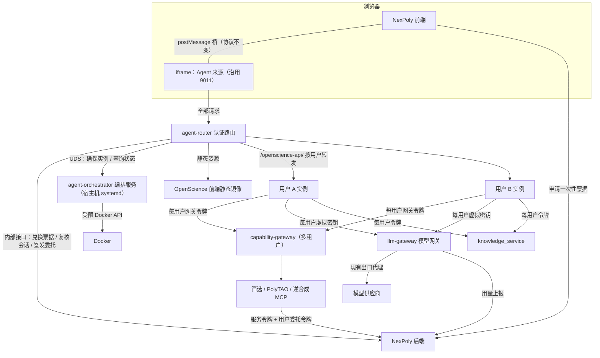
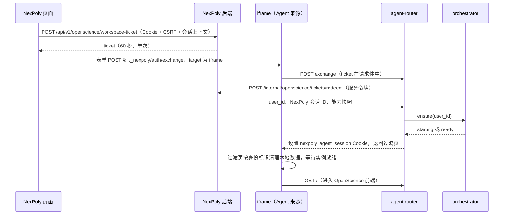
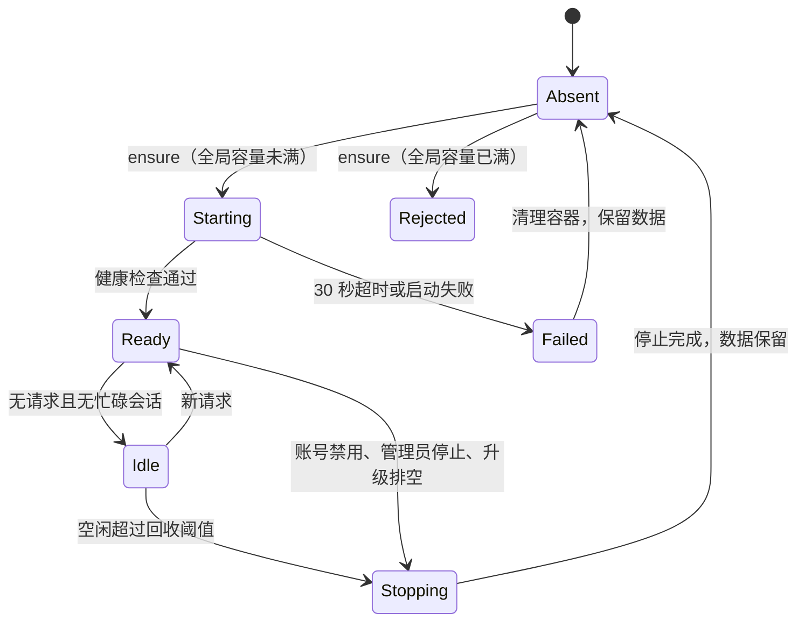
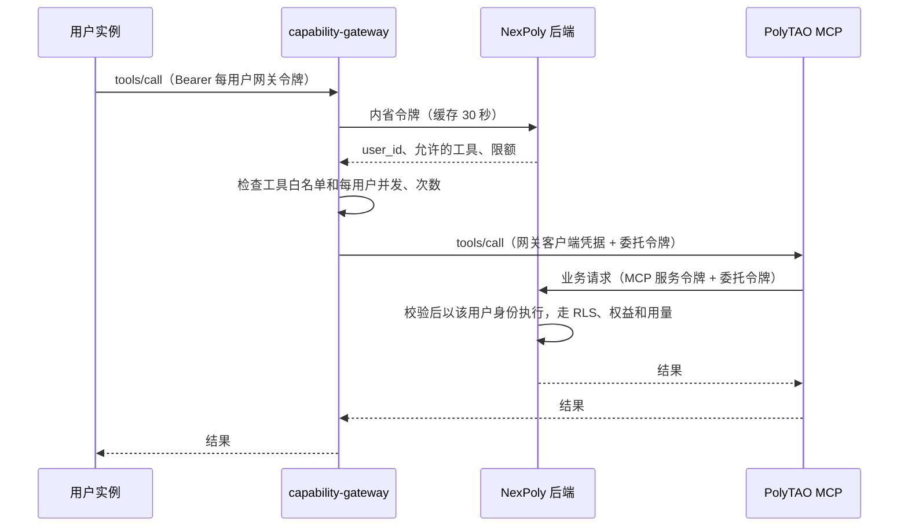
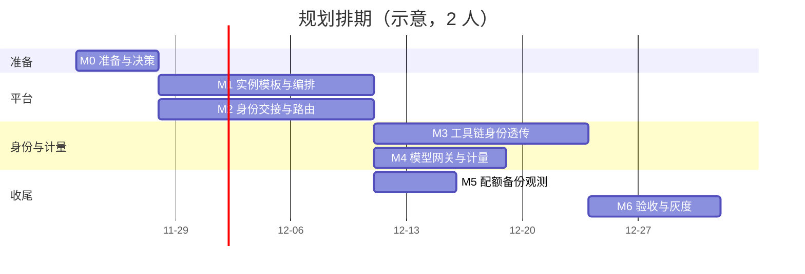

# OpenScience 每用户独立实例：规划与开发方案

> 编写日期：2026-11-19 · 代码基线：`2a7de60` · 状态：**规划草案，尚未实施**
>
> 本文对应“NexPoly 用户隔离覆盖 OpenScience”的方案 C（每用户独立实例），并包含必须同步完成的工具链身份透传（方案 E）和模型调用计量。所有现状判断以上述基线为准，实施前需按届时源码与实际部署重新核验。

## 0. 摘要

| 项目 | 结论 |
|---|---|
| 目标 | 每个 NexPoly 会员使用自己的 OpenScience 后端实例；会话、项目、文件、工具执行和下游 NexPoly 业务调用都归属真实用户，退出、禁用和改密后联动失效。 |
| 可行性 | 在现有单机（128 逻辑 CPU、约 251.5 GiB 内存）上可行。为 Agent 划出 32–64 GiB 内存时，可同时运行约 50–100 个实例，对应数百名注册用户。 |
| 首要瓶颈 | 不是内存，而是工具链限流（上游 MCP 每客户端 60 次/分钟、2 并发，代码只允许调低）、模型供应商限额和费用、GPU 队列。这些必须与 C 一起改造。 |
| 工作量 | 约 11–13 人周，2 名工程师约 7–9 个日历周，分 7 个里程碑（M0–M6）。 |
| 首批规模 | 先开放运维和内部成员，再按监控数据扩容到 20 个左右同时活跃用户。 |
| 不做的事 | 不迁移、不自动认领 9011 共享实例中的历史会话；首期不向普通用户开放 shell/命令类工具。 |

## 1. 背景与现状

### 1.1 当前集成方式



| 层面 | 现状 | 依据 |
|---|---|---|
| 入口 | 生产 9000 与开发 9001 共用同一个 9011；网络层只有源 IP 白名单 | [deployment.md](deployment.md)、[public-ingress-security.md](public-ingress-security.md) |
| 权限判断 | 仅 NexPoly 前端根据 `openscience.use` 决定是否挂载 iframe；9011 不校验身份 | [App.tsx](../frontend/src/App.tsx) 第 122 行 |
| 消息桥 | 只校验 origin 与 source，传 directory / sessionID，不含用户 | [openScienceProjectBridge.ts](../frontend/src/lib/openScienceProjectBridge.ts) |
| OpenScience 数据 | 单租户：一个项目根、一个普通工作区、一份记录和配置（含模型密钥） | [openscience_mcp_dev.py](../scripts/openscience_mcp_dev.py) 第 365 行起 |
| 工具调回 NexPoly | PolyTAO / 逆合成 MCP 使用固定 `account_uuid` 与会话文件 | [polytao_mcp.py](../backend/app/polytao_mcp.py) 第 52 行 |
| 用量与权益 | 用量目录注明“尚未接入可验证的 owner 与 usage”；权益为 `external` | [usage_catalog.py](../backend/app/usage_catalog.py) 第 202 行 |
| 已有定位 | “登录后的 OpenScience 继续保持已确认的共享服务例外” | [user-isolation.md](user-isolation.md) |

### 1.2 本方案要关闭的缺口

| 编号 | 缺口 | 本方案的处理 |
|---|---|---|
| G1 | 直接访问 9011 可绕过 NexPoly 登录 | 认证路由接管浏览器入口，原共享实例只在本机监听 |
| G2 | 所有会员共享同一份会话和项目列表，可互相重命名或删除 | 每用户独立实例和独立数据卷 |
| G3 | 工具在同一系统账号、同一数据根下执行 | 每用户独立容器、独立 UID、最小挂载 |
| G4 | 下游 NexPoly 调用都记在一个账号上 | 按用户委托令牌，RLS、配额、权益、用量对真实用户生效 |
| G5 | NexPoly 会话 Cookie 因不分端口被发送到 9011 | 路由在转发前删除 NexPoly Cookie，且不记录 Cookie |
| G6 | 切换账号后 9011 来源的浏览器数据残留 | 身份交换页按身份标识清理本地数据 |
| G7 | 模型密钥在 OpenScience 配置内、费用无法按人统计 | 模型网关持有真实密钥，实例只持有每用户虚拟密钥 |

## 2. 目标与非目标

**目标**

1. 会员只能看到、打开、修改自己的 OpenScience 会话、项目和文件；直接调用 API 或猜测会话 ID 也不能越权。
2. 不经 NexPoly 认证无法使用 Agent；退出、禁用、改密后 30 秒内切断访问，包括已建立的长连接。
3. Agent 发起的 NexPoly 业务调用以真实用户身份执行，走现有 RLS、启动授权、权益和用量记录。
4. 模型调用按用户计量，并支持每用户预算和并发限制。
5. 资源有上限：全局实例数、每实例内存/CPU/进程数、每用户磁盘配额；空闲实例自动回收。
6. 浏览器入口地址和消息桥协议保持兼容，NexPoly 前端只做小幅改动。

**非目标（本期不做）**

- 不改造 OpenScience 为原生多租户（方案 D），也不维护 OpenScience 前端源码分支。
- 首期不向普通用户开放 shell、终端、命令类工具；架构上为后续开放预留条件（第 6 节）。
- 不迁移 9011 共享实例的历史会话，不做“认领”。
- 不做多机调度和高可用；单机容量不足时另立项（第 11 节）。
- 不改变 NexPoly 自身的认证、会话和 RLS 设计。

## 3. 总体架构

### 3.1 目标拓扑



### 3.2 组件清单

| 组件 | 形态 | 职责 | 新增/改造 |
|---|---|---|---|
| NexPoly 后端 | 现有 FastAPI | 签发票据和委托令牌、复核会话、接收用量、委托身份认证 | 改造 |
| NexPoly 前端 | 现有 React | 挂载 iframe 前换取票据、处理容量不足等状态 | 小改 |
| `agent-router` | 新 Python ASGI 服务（Starlette + httpx） | 票据兑换、Agent 会话 Cookie、按用户转发、长连接撤销、删除 NexPoly Cookie、托管前端静态资源 | 新增 |
| `agent-orchestrator` | 新宿主机 systemd 服务，UDS 接口 | 按固定模板创建/启动/停止实例、分配 UID、空闲回收、全局容量 | 新增 |
| OpenScience 实例镜像 | 由已核验后端基础镜像派生 | 现有开发边界补丁、结构化结果补丁、服务端认证补丁 | 派生 |
| OpenScience 前端 | 现有已核验静态镜像 | 只提供静态资源，不再代理 API | 复用 |
| `capability-gateway` | 现有网关镜像 + 补丁 | 校验每用户令牌、按用户限流、向上游透传委托身份 | 改造 |
| MCP 适配器 | 现有 Python 服务 | 用委托身份替换固定账号会话 | 改造 |
| `llm-gateway` | 新薄代理（或评估 LiteLLM，见第 12 节） | 持有真实模型密钥、校验虚拟密钥、计量 token、执行预算 | 新增 |

### 3.3 入口与来源规划

- **保持浏览器入口地址不变**：`agent-router` 接管 9011 端口，原共享 OpenScience 前后端改为只在本机监听。这样 `VITE_AGENT_WORKSPACE_URL`、OpenScience 前端 overlay 的父页面白名单（只接受 9000、9001）和 CI 合同都不需要变化。
- **Agent 来源必须与 NexPoly 同站（same-site）**：
  - 现在两者是同一 IP 的不同端口，属于同站；
  - 以后改用域名时，两者必须在同一可注册域名下（例如 `nexpoly.example.com` 与 `agent.example.com`）；
  - 否则 iframe 内设置的 Cookie 会被浏览器当作第三方 Cookie 拦截。
- **不能把 Agent 挂到 NexPoly 同一来源的路径下**：同源 iframe 可以读取父页面内存中的 CSRF 令牌（见 [user-auth-and-isolation-analysis.md](user-auth-and-isolation-analysis.md) 第 10 节）。
- **改用 HTTPS 时**：NexPoly 与 Agent 必须同时切换，否则 HTTP iframe 会被当作混合内容拦截（[deployment.md](deployment.md)）。

## 4. 关键流程

### 4.1 身份交接（一次性票据）



要点：

- 票据放在表单请求体里，不进入 URL、Referer、代理日志或浏览器历史。
- 后端只保存票据的 SHA-256。兑换在一个事务内完成“未过期、未使用、所属 NexPoly 会话仍有效”的检查并标记已用。
- Agent 会话 Cookie 的属性：
  - 名称与 NexPoly 不同（`nexpoly_agent_session`）；
  - HttpOnly、仅主机、`SameSite=Lax`、`Path=/`；
  - 改用 HTTPS 后加 `Secure`。
- Agent 会话绑定 NexPoly 会话 ID。NexPoly 会话撤销后，Agent 会话随之失效。

### 4.2 请求路由与会话复核

1. 每个请求：根据 `nexpoly_agent_session` 找到 Agent 会话，得到 user_id，再找到实例地址。**实例地址只由服务端决定**，客户端传入的任何实例标识都忽略。
2. 复核：对 NexPoly 会话的复核结果缓存 30 秒；超时后调用 `/internal/openscience/sessions/validate`。
   - 复核失败：清除 Agent 会话，返回 401，过渡页提示回到 NexPoly 重新进入。
   - 后端不可用：在 2 分钟宽限期内继续使用缓存；超过宽限期后拒绝新请求。
3. 转发前：
   - 删除 `Cookie` 头中 NexPoly 的 Cookie（`nexpoly_session`、`nexpoly_dev_session`）和 Agent 自己的会话 Cookie；
   - 删除 `Authorization`；
   - 加上路由到该实例的密钥头。
4. 长连接（SSE 事件流）：
   - 关闭缓冲；
   - 路由每 30 秒复核一次所属会话，失效即主动断开；
   - 单个连接最长 1 小时，到期后由前端自动重连，重连时重新复核。
5. 日志：只记录 user_id 的哈希、路径模板、状态码和耗时；不记录 Cookie、请求体、提示词或工具结果。

### 4.3 实例生命周期



- **幂等**：同一用户多个标签页同时触发 `ensure` 时，编排服务按 user_id 加锁，只创建一个实例。
- **“忙碌”的判断**：路由在途请求数 > 0，或实例报告有运行中的会话轮次、等待审批的问题，或存在未结束的长时间工具调用。忙碌实例不回收。
- **回收**：空闲阈值默认 30 分钟；停止时先给 30 秒优雅退出（沿用开发 compose 的 `stop_grace_period`），容器删除，数据卷保留。
- **冷启动**：
  - 用户打开 NexPoly 主页时，前端可以提前申请票据进行预热；
  - 过渡页显示“正在启动工作空间”，健康检查通过后再进入；
  - 30 秒内未就绪则提示重试。
- **容量不足**：返回 503 `workspace_capacity`，前端显示“工作空间繁忙，请稍后重试”，不排队、不抢占他人实例。
- **崩溃与 OOM**：实例不自动重启（`restart: "no"`），下一次请求重新 `ensure`。同一用户 10 分钟内连续失败 3 次后暂停 10 分钟，并告警。

### 4.4 工具调用身份透传



- 委托令牌是不透明的随机令牌，NexPoly 只保存其 SHA-256，用内省接口校验。单机部署下内省开销很小，撤销也是即时的，不需要密钥轮换体系。
- 令牌有效期与 NexPoly 会话的绝对有效期对齐（默认 12 小时）。原因是 OpenScience 很可能只在启动时读取一次 `{file:…}` 配置；实例生命周期因此不超过所属 NexPoly 会话，会话结束即停止实例。
- 令牌的受众分为三类：`capability-gateway`、`llm-gateway`、`knowledge-service`。每个实例各持一份，互不通用。
- 参数板等“人工确认”动作继续使用独立的 UI 凭据，而且**该凭据移到实例之外**（第 5.7 节），模型无法获得。

### 4.5 退出、禁用、改密联动

| 事件 | NexPoly 后端 | 路由 | 编排服务 |
|---|---|---|---|
| 退出 | 撤销 NexPoly 会话，同一事务内撤销该会话签发的 Agent 会话和委托令牌 | 下次复核（≤30 秒）失效，断开长连接 | 该用户没有其他有效会话时停止实例 |
| 改密 | 撤销该用户全部会话、Agent 会话和委托令牌 | 同上 | 停止实例 |
| 禁用 | 沿用“先锁用户、再撤销会话”的顺序，并撤销委托令牌 | 同上 | 立即停止实例 |
| 失去 `openscience.use` | 复核返回无权限 | 返回 403 | 停止实例 |

撤销令牌后，网关、模型网关和 NexPoly 后端会在缓存过期（≤30 秒）后拒绝调用。正在执行的 GPU 任务按现有“已开始”语义安全收尾，不提前释放额度。

## 5. 详细设计

### 5.1 NexPoly 后端

**新增迁移 `0027_openscience_agent`**（编号接在 `0026_monomer_retrosynthesis_jobs` 之后，按 [postgres-migration-governance.md](postgres-migration-governance.md) 登记）：

| 表 | 主要字段 | 访问 |
|---|---|---|
| `openscience_workspace_tickets` | `ticket_sha256`、`owner_user_id`、`auth_session_id`、`created_at`、`expires_at`、`consumed_at` | API 角色写入；service 角色兑换 |
| `openscience_agent_sessions` | `id_sha256`、`owner_user_id`、`auth_session_id`、`created_at`、`expires_at`、`revoked_at` | service 角色 |
| `openscience_delegations` | `token_sha256`、`owner_user_id`、`agent_session_id`、`audience`、`scopes`、`expires_at`、`revoked_at` | service 角色；撤销与会话撤销同事务 |

- 三张表都按 `owner_user_id` 归属。API 角色只能为本人创建票据，不能读取其他表。
- 会话撤销路径（退出、改密、禁用）增加对 Agent 会话与委托令牌的撤销，与 `auth.sessions` 在同一事务内完成。
- 过期记录由已有的后台清理任务定期删除。

**公开接口**

| 接口 | 权限 | 请求/响应 |
|---|---|---|
| `POST /api/v1/openscience/workspace-ticket` | 会员 + CSRF + 会话上下文 + `openscience.use` + 权益检查 | `{}` → `{ticket, expires_at, exchange_url}`；无权限 403；首次改密未完成 403 |

**内部接口**（`/internal/` 已由公共 nginx 返回 404；只在后端私有监听地址提供，沿用 DFT 启动授权的服务令牌校验方式）

| 接口 | 调用方 | 说明 |
|---|---|---|
| `POST /internal/openscience/tickets/redeem` | agent-router | 兑换票据，返回 `{user_id, auth_session_id, capabilities, session_expires_at}` |
| `POST /internal/openscience/sessions/validate` | agent-router | 复核 Agent 会话与对应 NexPoly 会话是否有效 |
| `POST /internal/openscience/delegations` | agent-router | 为实例签发三类委托令牌，有效期不超过 NexPoly 会话 |
| `POST /internal/openscience/delegations/introspect` | 网关、模型网关、知识库、MCP | 返回 `{active, user_id, audience, scopes, limits}` |
| `POST /internal/openscience/usage` | llm-gateway | 上报 token 用量（幂等键为请求 ID） |

每个调用方使用各自独立的服务令牌，不复用 `MONOMER_DFT_START_AUTHORIZATION_TOKEN`。

**委托身份认证模式**：在 [auth/middleware.py](../backend/app/auth/middleware.py) 增加一种认证方式：`Authorization: Bearer <MCP 服务令牌>` 加 `X-NexPoly-Delegation: <委托令牌>`。

- 只对白名单路由生效：PolyTAO 草稿与任务、描述符、逆合成、性质预测、单体聚合、DFT 提交与查询。白名单以外的路由一律拒绝。
- 校验通过后设置该用户的身份上下文，走与浏览器请求相同的 RLS、启动授权、权益和用量中间件。
- 不需要 CSRF，因为没有 Cookie；但必须同时提供 MCP 服务令牌，单独的委托令牌无效。
- 幂等键按 user_id 加命名空间，现有适配器已按 client_id 和账号加命名空间，需要改为按 user_id。

**权益与用量**

- `openscience` 权益从 `external` 改为可计量模式：按日 token 预算和实例时长。具体额度属于产品决策（第 12 节）。
- Agent 调用的业务工具按原生模块计量（例如 PolyTAO 计入 `polytao`），并标记来源为 `openscience`，不重复计数。
- 模型 token 和实例时长计入 `openscience` 模块。[usage_catalog.py](../backend/app/usage_catalog.py) 中 `openscience` 的覆盖说明随之更新。

### 5.2 agent-router（认证路由）

| 功能 | 设计 |
|---|---|
| 技术选型 | Python 3.12、Starlette + uvicorn 单进程异步、httpx 流式转发。选它是因为团队测试基础设施以 Python 为主，单机约 100 条并发长连接足够。 |
| 路由表 | `/_nexpoly/auth/exchange`（票据交换）、`/_nexpoly/status`（实例状态，供过渡页轮询）、`/openscience-api/*`（转发到本人实例）、`/knowledge-api/*`（转发到知识库，附每用户令牌）、其余路径转发到前端静态镜像 |
| 会话存储 | Agent 会话以 NexPoly 数据库为准，路由在内存中缓存 30 秒 |
| 请求处理 | 删除 NexPoly 与 Agent 的 Cookie 和 `Authorization`，加上实例密钥头；拒绝跟随重定向；限制请求体大小（沿用前端已有的 25 MB 上限） |
| 撤销 | 在途长连接登记在内存表中，复核失败时主动关闭 |
| 安全头 | 设置 `frame-ancestors`，只允许 9000、9001 两个来源嵌入 |
| 部署 | 容器，只读根文件系统，去掉所有 capabilities；加入实例网络和后端私有网络；对外只发布 9011 |

### 5.3 agent-orchestrator（编排服务）

- **运行方式**：宿主机 systemd 服务，使用独立系统账号，通过受限的 Docker socket 代理访问 Docker。持有 Docker API 约等于 root，所以**不放进 NexPoly 后端或路由进程**。
- **接口**：UDS（目录 0700、socket 0600，属主为路由的 UID），与仓库中 DFT Worker 的 UDS 模式一致。只有三个动作：
  - `ensure(user_id)`；
  - `stop(user_id, reason)`；
  - `status(user_id)`。

  **参数里只有 user_id**，镜像、挂载、命令、资源上限、网络全部来自编排服务自己的固定模板，调用方无法改变。
- **状态**：容器的运行状态以 Docker 标签为准。UID 分配和实例元数据保存在编排服务私有目录下的 SQLite 中（0600）。
- **UID 分配**：每个用户分配预留区间（例如 200000–299999）中的固定 UID，首次创建时分配，之后不变。
- **全局容量**：`AGENT_MAX_INSTANCES` 默认 20，达到后 `ensure` 返回容量不足。
- **回收**：每分钟扫描一次。同时满足两点才停止：编排服务记录的最后活动时间超过阈值，并且路由在途计数为 0（路由定期上报）。
- **升级排空**：新模板版本发布后，新建实例使用新版本；运行中的实例在下次空闲回收后自然换新；需要强制时执行 `drain --template <old>`。
- **管理命令**：只提供列出、停止、查看状态，**不提供读取用户会话内容的命令**。

### 5.4 实例镜像与配置模板

**镜像**：从已核验的后端基础镜像（当前为 `openscience-backend-poc:release-20261029`）派生，沿用 [ops/openscience-mcp-dev/Dockerfile](../ops/openscience-mcp-dev/Dockerfile) 的“固定源码哈希、锚点唯一替换”补丁方式，包含：

1. 现有 `dev-boundary.mjs`：配置脱敏、禁止通过 HTTP 修改配置或 MCP、禁用终端和会话 shell/命令、文件访问限制在工作区内、禁止通过请求提升工具权限；
2. 现有结构化结果补丁和会话绑定 `conversation_id` 补丁；
3. 新增服务端认证：每个请求必须带路由加入的实例密钥头，缺失返回 401。M0 先确认 OpenScience 是否已有可用的服务端密码机制，有则用配置方式启用，没有再补丁；
4. 新增健康与忙碌状态接口，供编排服务判断能否回收。M0 先确认能否由现有 `/session/status` 类接口推导。

**容器模板**（在开发 compose 的加固基础上收紧）

| 项目 | 值 |
|---|---|
| 用户 | 该用户分配的 UID:GID |
| 资源 | `mem_limit: 2g`（swap 同值）、`cpus: 1`、`pids_limit: 256`、`nofile` 4096 |
| 安全 | `cap_drop: [ALL]`、`no-new-privileges`、只读根文件系统（M1 验证 bun 的运行时写入路径）、`/tmp` tmpfs 64 MB 且 `noexec,nosuid` |
| 环境 | `OPENSCIENCE_DISABLE_AUTOUPDATE=1`、`OPENSCIENCE_DISABLE_PROJECT_CONFIG=1`、`OPENSCIENCE_UMASK=0077`，XDG 目录指向用户数据卷 |
| 挂载 | 用户数据卷（读写）；配置模板（只读，不含任何密钥）；三个委托令牌文件（只读，0400） |
| 网络 | 只加入实例网络（`internal: true`），不发布宿主端口 |
| 重启 | `restart: "no"`，由编排服务决定 |

**配置模板**：复用 [openscience_mcp_dev.py](../scripts/openscience_mcp_dev.py) 中 `configuration()` 的校验和复制逻辑（JSONC 解析、提供方和 MCP 端点校验、Agent 与权限继承），差别如下：

- 模型提供方的 `baseURL` 改为 `http://llm-gateway:8080/v1`，`apiKey` 改为 `{file:/run/openscience/llm-token}`。DeepSeek 等其他提供方同样改走模型网关。
- `capability_gateway` 的 `Authorization` 改为 `Bearer {file:/run/openscience/gateway-token}`，但令牌是每用户委托令牌。
- `knowledge_service` 的认证头改为 `Bearer {file:/run/openscience/knowledge-token}`，不再使用共享的静态头（需要知识库服务支持内省，见 M0）。
- 全局权限保持 `external_directory: deny`；首期 `bash` 等命令类工具对所有 Agent 设为 `deny`。
- 模板文件按版本生成并做哈希登记。**模板中不出现任何真实凭据**，因此可以所有实例共享只读挂载。

### 5.5 存储与配额

```text
/data/nexpoly-agent/                     0711 root
  users/<user_uuid>/                     0700 <uid>
    files/general/  files/projects/      工作区
    records/  data/  state/  cache/  home/
  templates/<version>/openscience.json   0444 root
  tokens/<user_uuid>/{gateway,llm,knowledge}-token   0400 <uid>（实例停止时删除）
```

- **配额**：默认每用户 2 GB。M0 确认数据盘的文件系统：XFS 用项目配额；ext4 需要 `prjquota` 挂载选项。都不可用时，用编排服务每小时统计目录大小作为软限制：超限后拒绝新会话，只允许查看和删除。
- **保留期**：会话默认长期保留，由用户自行删除；账号删除不级联删除数据，与 NexPoly “普通账号删除不级联删除科研资产”的政策一致，处置流程另定。
- **备份**：纳入现有备份流程，按用户目录增量备份；恢复后需重新核对 UID 与目录归属。
- **增长估算**：实测约 0.2 MB/轮，含工具结果时按 0.3–1 MB/轮估算。100 名活跃用户每人每天 30 轮，一年约 0.5–2.5 TB 上限，实际远低于此；需要配合保留策略。

### 5.6 网络隔离

| 流量 | 是否允许 |
|---|---|
| 路由 → 实例:4096 | 允许 |
| 实例 → capability-gateway、llm-gateway、knowledge-service 的指定端口 | 允许 |
| 实例 → 实例 | **拒绝** |
| 实例 → 外网、宿主机、NexPoly 后端、数据库 | **拒绝** |

- 实例网络使用 `internal: true` 的独立网桥，阻断外网出口。
- 同一网桥内容器之间的流量，在宿主机 `DOCKER-USER` 链中按 IP 和端口放行上表所列的几项，其余丢弃。
  - 编排服务为实例分配固定子网内的 IP。
  - 规则由 root 管理的脚本维护，复用 [public_ingress_firewall.py](../scripts/public_ingress_firewall.py) 的 nftables 运维方式。
  - M1 验证宿主机的 `br_netfilter` 与 iptables/nftables 后端行为。
- 实例密钥头是第二道防线：即使网络规则失效，实例之间也无法调用对方的 API。

### 5.7 capability-gateway 多租户改造

网关源码不在本仓库，当前由基础镜像 `openscience-capability-gateway:91f5d81-release-20261111` 加锚点补丁派生（[ops/capability-gateway-dev](../ops/capability-gateway-dev)）。多租户改造量明显大于现有补丁，**建议在 M0 决定把网关源码纳入本仓库维护**（第 12 节决策 D2）。

改造内容：

1. **入站认证**：每次调用都对每用户令牌做内省（缓存 30 秒），取得 user_id、允许的工具和限额。去掉“任何持有共享令牌者都能访问”的路径。
2. **按用户限流**：默认每用户 1 个并发、每分钟 20 次；同时设全局上限，不超过上游容量。
3. **透传身份**：调用上游 MCP 时附带委托令牌；草稿归属键加上 user_id 命名空间。
4. **参数板确认移出实例**：现在参数板桥接运行在 OpenScience 后端内，并挂载了 UI 凭据（[docker-compose.openscience-mcp-dev.yml](../docker-compose.openscience-mcp-dev.yml) 第 135 行）。改为：
   - 路由提供 `/openscience-api/nexpoly/*`，由路由持有 UI 凭据调用网关的确认工具；
   - 回执通过实例的内部接口写入会话。

   即使模型或将来开放的命令工具能伪造回执，也只影响本人会话的展示，**不能提交任何任务**。

### 5.8 MCP 适配器

| 适配器 | 现状 | 改造 |
|---|---|---|
| PolyTAO（[polytao_mcp.py](../backend/app/polytao_mcp.py)） | 固定 `account_uuid` + 会话文件（Cookie、CSRF、会话上下文） | 删除固定会话，改为“MCP 服务令牌 + 委托令牌”调用后端；幂等键改按 user_id 加命名空间 |
| 逆合成（[retrosynthesis_mcp.py](../backend/app/retrosynthesis_mcp.py)） | 同上 | 同上 |
| 数据库筛选（[property_filter_mcp.py](../backend/app/property_filter_mcp.py)） | 只读数据库角色直连共享底库 | 数据仍然共享；委托身份只用于按用户限流和用量 |
| 限流（[mcp_security.py](../backend/app/mcp_security.py)） | 按 client_id 计数，配置只允许调低（≤60 次/分钟、≤2 并发） | 改为按“client_id + user_id”计数，并提高全局上限；放宽上限要单独评审 |

### 5.9 llm-gateway（模型网关）

- **协议**：兼容 OpenAI 的 Chat Completions 和 Responses 两种接口（当前配置同时用到 `@ai-sdk/openai-compatible` 与 `@ai-sdk/openai`，见 [openscience-luna-responses.merge.json](../ops/config/openscience-luna-responses.merge.json)），流式透传。
- **认证**：校验每用户虚拟密钥（内省），换成真实密钥后转发。真实密钥只在模型网关的 0600 文件中。
- **出口**：沿用现有出口路径：`model-proxy` → 私有 UDS → `model-egress` → 宿主机代理，只允许 `CONNECT api.relayrouter.ai:443`。DeepSeek 端点同样改走模型网关。
- **计量**：从响应的 `usage` 字段（流式为最后一个片段）读取 token 数，按请求 ID 幂等上报 NexPoly。配置模板需确保提供方开启流式用量返回。读不到用量时按请求和响应字节估算并标记“估算”。
- **预算**：每用户日 token 预算和并发上限（默认 2 条流）。超出返回 429 和明确的提示文本。
- **日志**：只记 user_id 哈希、模型、token 数、耗时、状态，不记录提示词和回复。

### 5.10 NexPoly 前端

- [AgentWorkspaceHomePage.tsx](../frontend/src/components/AgentWorkspaceHomePage.tsx)：挂载 iframe 前申请票据，iframe 先加载空白页，再用隐藏表单 POST 到交换地址。
  - 处理 403（无权限，沿用现有提示）、503（工作空间繁忙）和网络错误（允许重试）。
- 身份变化（现在已有按 `user.id:session_id` 重新挂载的逻辑）时重新申请票据。
- 打开 NexPoly 主页但尚未进入 Agent 时，可以提前申请票据触发预热，由开关控制。
- 消息桥协议不变。OpenScience 端返回的项目和会话快照自然只包含本人数据。
- **本地数据清理**：交换过渡页由路由提供，与 Agent 同源。
  - 过渡页读取 Agent 来源 `localStorage` 中保存的身份标识（user_id 的 HMAC，不是 user_id 本身）；
  - 身份不同就清空该来源的 `localStorage`、`sessionStorage`、IndexedDB，再写入新标识；
  - 在 HTTP 下有效，不依赖只在 HTTPS 下生效的 `Clear-Site-Data`。

### 5.11 观测与审计

| 指标 | 用途 |
|---|---|
| 实例数（运行、空闲、启动中）、容量拒绝次数 | 判断是否扩容 |
| 每实例内存、OOM 次数、启动耗时 P50/P95 | 校准资源上限与预热策略 |
| 工具调用 QPS、被限流次数、上游错误 | 判断工具链瓶颈 |
| 每用户与全局 token 用量、预算拒绝次数 | 成本控制 |
| 委托令牌签发、撤销、内省失败次数 | 安全审计 |

- 指标可接入现有服务器监测（9003）的数据源。
- 审计事件包括实例创建、停止、回收、强制停止、容量拒绝、令牌撤销，记录 user_id，不记录内容。

## 6. 安全设计要点

| 威胁 | 控制措施 |
|---|---|
| 直接访问 Agent 入口绕过登录 | 路由是唯一对外入口；原 9011 改为只在本机监听；保留源 IP 白名单作为网络层缓解 |
| 篡改实例或会话标识访问他人数据 | 实例地址由服务端根据身份决定；每个实例只挂载本人数据 |
| 实例之间横向访问 | 独立网桥、`DOCKER-USER` 规则、实例密钥头 |
| 实例内读取平台密钥 | 实例内没有真实模型密钥、没有共享网关令牌、没有 UI 确认凭据，只有本人、有受众限制的委托令牌 |
| 模型绕过人工确认提交 GPU 任务 | 确认动作在实例外由路由持 UI 凭据完成 |
| NexPoly Cookie 被送入 Agent | 路由转发前删除；路由不记录 Cookie |
| 票据泄露或重放 | 60 秒、单次、只存哈希、只走请求体、绑定 NexPoly 会话 |
| 撤销不及时 | 30 秒复核、主动断开长连接、委托令牌内省缓存 30 秒 |
| 提示注入导致数据外传 | 实例无外网，只能访问三项内部服务，每项都按本人身份授权 |
| 编排服务被滥用 | UDS 0600、参数只有 user_id、模板固定、独立系统账号 |
| 资源耗尽 | 全局实例上限、每实例 cgroup 限制、每用户磁盘配额、模型预算 |

**将来开放命令类工具的前提**（不在首期）：

1. 上述“实例内无平台凭据”全部落实；
2. 实例无外网、无宿主机挂载；
3. 增加 seccomp 配置并评估 gVisor 等更强的运行时；
4. 单独做一轮安全评审和 A/B 验收。

## 7. 容量规划与成本

### 7.1 单实例实测（代理基准）

当前环境没有 OpenScience 镜像。2026-11-19 使用同源的 opencode 1.19.6（同为 bun 运行的 `serve` 模式）加本地假模型服务，在 4 核 16 GB 容器中测得：

| 状态 | 常驻内存 RSS | 每实例独占部分 |
|---|---|---|
| 刚启动，无请求 | 约 230 MB | 约 170 MB |
| 第一轮对话后 | 约 466 MB | 约 368 MB |
| 1 个会话 30 轮（每轮约 60 KB 文本） | 约 517 MB | 约 440 MB |
| 5 个会话并发各 10 轮的峰值 | 约 646 MB | 约 569 MB |
| 活动结束 30 秒后 | 约 445 MB | 约 366 MB |

- 冷启动约 2 秒；空闲 CPU 约为单核的 0.1–0.3%；约 80 轮对话占磁盘 16 MB。
- 用过的实例空闲后保持约 450 MB，不会回落，所以空闲回收是控制成本的关键。
- OpenScience 用 bun 直接运行 TS 源码、启动时连接 MCP、挂载文献检索运行时，因此**规划值放大约 1.5 倍**：活跃实例 1 GB、空闲未回收实例 0.5 GB、上限 2 GB。M0 用真实镜像校准。

### 7.2 能支撑多少用户

宿主机：2×Xeon Gold 6530（128 逻辑 CPU）、约 251.5 GiB 内存、4 张 RTX 4090（[server-monitoring-9003.md](server-monitoring-9003.md)），同时运行 NexPoly 生产与开发、MD、DFT、batch、PostgreSQL 等。

| Agent 内存预算 | 并发实例（全部活跃） | 并发实例（典型混合，平均约 0.65 GB） | 对应注册用户（峰值在线率 15–25%，假设值） |
|---|---|---|---|
| 16 GiB | 约 16 | 约 25 | 约 100–160 |
| 32 GiB | 约 32 | 约 50 | 约 200–330 |
| 64 GiB | 约 64 | 约 100 | 约 400–650 |

其他瓶颈及其大致上限：

| 瓶颈 | 改造前 | 改造后的处理 |
|---|---|---|
| 上游 MCP 限流 | 全部用户共用一个客户端：60 次/分钟、2 并发，约 15–20 名同时活跃用户就会被拒 | 按用户限流 + 提高全局上限（M3） |
| 模型出口 | `model-proxy` 64 MB / 0.25 CPU，只做隧道 | 模型网关集中出口，按压测结果调整资源（M4） |
| 模型供应商限额 | 每分钟请求数和 token 数未知 | M0 查合同，设置全局与每用户预算 |
| GPU | 沿用现有准入与租约 | Agent 提交的任务按用户进入现有配额 |
| 单机 Docker | 50–100 个容器无压力 | 超过约 100 个并发或需要高可用时另立项 |

### 7.3 成本

| 类别 | 估算 |
|---|---|
| 一次性开发 | 约 11–13 人周（第 8 节） |
| 硬件 | 50 个并发以内不新增硬件；从现有内存划出 32–64 GiB；磁盘按每用户 2 GB 配额，200 用户最多 400 GB |
| 持续运维 | 每次 OpenScience 升级需要更新模板、滚动替换实例、验证用户数据迁移；监控和容量调整常态化 |
| 模型调用 | 与共享实例相同的 token 消耗，是最大的变动成本。月成本 ≈ 活跃用户 × 每人每日轮次 × 每轮 tokens × 单价 × 工作日。M0 从 9011 记录中统计实际分布：同源实现中每条助手消息带有 `tokens` 与 `cost` 字段 |

## 8. 里程碑与工期

| 里程碑 | 内容 | 产出 | 工作量 | 退出条件 |
|---|---|---|---|---|
| **M0 准备与决策** | 1. 在开发机用真实镜像跑 3 个实例，测内存、冷启动、磁盘增长<br/>2. 统计 9011 记录中的 token 分布<br/>3. 确认 OpenScience 服务端认证与忙碌状态接口<br/>4. 审查 knowledge-service 的多用户能力<br/>5. 确认数据盘配额方式和 `br_netfilter` 行为<br/>6. 完成第 12 节决策 | 基线报告、决策记录 | 1 人周 | 所有“待核实”项有结论；规划值已用实测替换 |
| **M1 实例模板与编排** | 实例镜像与补丁；配置模板生成器；编排服务（UDS、模板、UID、生命周期、回收、全局容量）；网络规则脚本 | 镜像、编排服务、systemd 单元、规则脚本 | 2.5 人周 | 本机可按 user_id 启停实例；实例互访被拒；模板无凭据 |
| **M2 身份交接与路由** | 迁移 0027；票据、兑换、复核接口；agent-router；前端票据交换与容量提示；本地数据清理 | 后端接口、路由服务、前端改动 | 2.5 人周 | 双用户浏览器测试：各自只看到本人会话；退出 30 秒内断开 |
| **M3 工具链身份透传** | 委托令牌签发与内省；后端委托认证模式；网关多租户改造与参数板确认移出实例；MCP 适配器改造；按用户限流 | 网关新版本、适配器新版本 | 2.5 人周 | Agent 提交的 PolyTAO/逆合成任务记在真实用户名下，受该用户配额约束 |
| **M4 模型网关与计量** | llm-gateway；虚拟密钥；用量上报；预算；实例中移除真实密钥 | 模型网关服务 | 1.5 人周 | 实例内找不到任何真实密钥；用量页能看到本人 token |
| **M5 配额、备份、观测** | 磁盘配额；备份与恢复演练；指标与告警；管理命令 | 运维文档、仪表板 | 1 人周 | 配额生效；恢复演练通过；告警可触发 |
| **M6 验收与灰度** | 第 9 节验收矩阵；用假模型压测 30/50 实例；安全评审；按“运维 → 5 人 → 20 人”逐步开放；原 9011 转为只读存档 | 验收报告 | 1.5 人周 | 验收矩阵全部通过；灰度期无越权事件 |

- 合计约 12.5 人周。
- M1 与 M2 可以并行；M3 依赖 M2 的委托令牌签发；M4 可与 M3 并行。
- 2 名工程师约需 7–9 个日历周。



## 9. 验收与测试

### 9.1 A/B 双用户验收矩阵

| 编号 | 场景 | 期望 |
|---|---|---|
| AC-01 | A、B 分别登录并打开 Agent | 各自实例启动；侧栏只显示本人项目和会话 |
| AC-02 | B 使用 A 的会话 ID 调用 `/openscience-api/session/<id>/message` | 404 或 403，不泄露任何内容 |
| AC-03 | B 在请求中伪造 directory 参数或 `x-openscience-directory` 指向 A 的路径 | 拒绝；B 的实例本来就没有挂载 A 的目录 |
| AC-04 | 不经 NexPoly、直接访问 9011 | 只能看到“请从 NexPoly 进入”，无 API 访问 |
| AC-05 | 重放已使用或已过期的票据 | 拒绝 |
| AC-06 | A 退出 | 30 秒内 A 的长连接断开、请求返回 401；A 的实例停止 |
| AC-07 | 禁用 A，同时 A 有运行中的 Agent 轮次 | 新调用被拒；已经授权开始的 GPU 任务按现有语义收尾 |
| AC-08 | 同一浏览器从 A 切换到 B | 不出现 A 的本地草稿、最近会话或界面状态 |
| AC-09 | A 的实例尝试访问 B 实例的 4096 端口 | 网络层拒绝；绕过网络规则后也因缺少实例密钥被拒 |
| AC-10 | 在 A 实例内查找模型密钥、共享网关令牌、UI 确认凭据 | 都不存在 |
| AC-11 | A 通过 Agent 提交 PolyTAO 生成 | 任务归属 A；计入 A 的配额和用量；B 不可见 |
| AC-12 | 模型生成文字声称“已确认”，或伪造回执 | 不会提交任何任务 |
| AC-13 | A 超出每用户工具调用限额 | A 收到限流提示；B 不受影响 |
| AC-14 | A 超出日 token 预算 | 模型调用返回 429 和提示；其他用户正常 |
| AC-15 | 达到全局实例上限后，新用户进入 | 显示“工作空间繁忙”，已有用户不受影响 |
| AC-16 | 实例 OOM | 只影响该用户；下次进入重新启动，数据完好 |
| AC-17 | A 超出磁盘配额 | 新会话被拒，可查看、删除；其他用户不受影响 |
| AC-18 | 升级模板版本 | 新实例使用新版本；运行中的实例回收后换新；用户数据可读 |
| AC-19 | 失去 `openscience.use` 能力 | 下次复核返回 403；实例停止 |
| AC-20 | 原 9011 共享实例 | 只在本机监听；普通会员不可访问 |

### 9.2 自动化测试

| 层次 | 内容 | 归属 CI 任务 |
|---|---|---|
| 后端单元与集成 | 票据、兑换、复核、委托令牌的生命周期；撤销与会话同事务；委托认证的路由白名单；一次性 PostgreSQL 16 下的 RLS | `backend-tests`、`postgres-media-integration` |
| 路由 | 删除 Cookie、实例映射不可被客户端影响、长连接撤销、请求体上限、日志不含敏感头 | 新增 `agent-router-tests` |
| 编排 | 模板渲染不接受调用方参数、UID 分配幂等、回收条件、容量上限 | 新增 `agent-orchestrator-tests` |
| 镜像 | 实例镜像补丁哈希锚点、只读根文件系统、配置模板无凭据 | 扩展 `mcp-derived-images` |
| 网关与适配器 | 每用户令牌、按用户限流、委托透传、参数板确认只走 UI 凭据 | 扩展 `confirmed-mcp-adapter-tests` |
| 浏览器 | Playwright 双用户：票据交换、侧栏隔离、切换账号清理、退出断开 | 扩展 `openscience-overlay` 或新增任务 |
| 压测（手动） | 假模型服务 + 30/50 个实例并发，记录内存、启动耗时、路由延迟 | M6 验收报告 |

## 10. 上线、迁移与回滚

1. **准备**：部署模型网关、网关新版本和 MCP 适配器新版本；此时共享 9011 不受影响。
2. **切换入口**：
   - 原 9011 前后端改为只在本机监听（例如 `127.0.0.1:19011`），作为只读存档，只供运维通过 SSH 转发访问；
   - 路由接管 9011；
   - `openscience.use` 先只授予运维和内部成员（复用现有权益与验收账号机制）。
3. **灰度**：运维 → 5 名内部用户 → 20 名同时活跃用户。每一步至少观察 3 个工作日：越权事件为 0、OOM 和启动失败率、限流与预算拒绝次数。
4. **历史数据**：
   - 共享实例中的会话没有归属，不做自动认领；
   - 需要找回历史对话时，由运维从存档中导出，经本人确认后交付；
   - 存档保留期由产品决定。
5. **回滚**：
   - 回滚的含义是**关闭普通会员的 Agent 入口**（收回 `openscience.use`），而不是回到共享实例；
   - 每用户实例的数据保留，问题修复后恢复开放；
   - 路由故障时，前端按现有逻辑显示无权限或同步占位，不影响 NexPoly 其他模块。

## 11. 风险登记

| 风险 | 可能性 | 影响 | 应对 |
|---|---|---|---|
| 真实镜像内存明显高于规划值 | 中 | 可承载并发减少 | M0 实测校准；调低全局上限；缩短回收阈值 |
| OpenScience 没有服务端认证或忙碌状态接口 | 中 | 需额外补丁 | M0 确认；补丁沿用锚点哈希方式 |
| OpenScience 升级改变补丁锚点或存储格式 | 高 | 每次升级都要重做补丁并验证数据迁移 | 固定基础镜像摘要；升级前备份；CI 锚点校验失败即阻断 |
| 网关源码不可维护，多租户只能靠补丁 | 中 | 改造风险和维护成本上升 | 决策 D2：纳入本仓库维护 |
| knowledge-service 不支持按用户鉴权 | 中 | 知识库成为残留的共享面 | M0 审查；不满足时经网关代理并按用户限流，会话状态另行隔离 |
| 冷启动体验差 | 中 | 用户等待 | 预热、过渡页、调整回收阈值 |
| `DOCKER-USER` 规则与宿主机现有防火墙冲突 | 低 | 横向隔离失效或误拦 | M1 在开发机验证；有实例密钥作为第二道防线 |
| 模型费用不可控 | 中 | 成本上升 | 每用户预算、全局预算告警 |
| 单机故障 | 低 | Agent 全部不可用 | 本期接受；数据卷纳入备份 |
| 普通用户要求开放命令类工具 | 中 | 安全面扩大 | 按第 6 节前提单独评审 |

## 12. 待决事项

| 编号 | 决策 | 建议 |
|---|---|---|
| D1 | Agent 内存预算与首期全局实例上限 | 32 GiB、20 个实例起步 |
| D2 | capability-gateway 源码是否纳入本仓库维护 | 纳入；补丁方式难以承载多租户改造 |
| D3 | 模型网关自研薄代理还是采用 LiteLLM | 自研薄代理：受控面小，只需透传、计量和预算三项能力 |
| D4 | 每用户日 token 预算、工具调用限额、磁盘配额 | 先按 M0 统计的 P90 用量设置，灰度期调整 |
| D5 | 空闲回收阈值 | 30 分钟 |
| D6 | 9011 历史会话存档的保留期和找回流程 | 只读保留 6 个月，经本人确认后由运维导出 |
| D7 | 是否继续为开发父页面 9001 提供每用户实例 | 开发环境使用独立的编排实例和数据根，不与生产混用 |
| D8 | 何时评估开放命令类工具 | 首期结束后，满足第 6 节前提再评审 |

## 附录 A：默认参数

| 参数 | 默认值 | 说明 |
|---|---|---|
| `AGENT_MAX_INSTANCES` | 20 | 全局同时运行的实例上限 |
| `AGENT_IDLE_TIMEOUT_SECONDS` | 1800 | 空闲回收阈值 |
| `AGENT_START_TIMEOUT_SECONDS` | 30 | 启动超时 |
| `AGENT_INSTANCE_MEMORY` | 2g | 每实例内存上限（swap 同值） |
| `AGENT_INSTANCE_CPUS` | 1 | 每实例 CPU |
| `AGENT_INSTANCE_PIDS` | 256 | 每实例进程数 |
| `AGENT_USER_DISK_QUOTA` | 2 GB | 每用户磁盘配额 |
| `AGENT_TICKET_TTL_SECONDS` | 60 | 票据有效期 |
| `AGENT_SESSION_REVALIDATE_SECONDS` | 30 | 会话复核间隔 |
| `AGENT_STREAM_MAX_SECONDS` | 3600 | 单条长连接最长时间 |
| `GATEWAY_USER_CONCURRENCY` / `GATEWAY_USER_CALLS_PER_MINUTE` | 1 / 20 | 每用户工具调用限额 |
| `LLM_USER_CONCURRENCY` | 2 | 每用户并发模型流 |

## 附录 B：基准测试方法

1. 安装 `opencode-ai@1.19.6`，为每个实例设置独立的 HOME 与 XDG 目录，执行 `serve`。
2. 用一个本地兼容 OpenAI 的流式服务模拟模型：每轮返回约 60 KB 文本，并附带 `usage`。
3. 通过 `POST /session` 和 `POST /session/<id>/message` 驱动对话。
4. 从 `/proc/<pid>/status` 与 `/proc/<pid>/smaps_rollup` 读取 RSS 和独占内存。

结果只用于量级判断。M0 需在开发机上用真实镜像复测，例如：

```bash
docker stats --no-stream openscience-backend-20260928
```

## 附录 C：相关文档

- [用户管理、资产隔离与任务控制](user-isolation.md)
- [用户登录、权限与数据隔离分析](user-auth-and-isolation-analysis.md)（第 10、11 节）
- [普通用户 MVP 与任务协调](ordinary-user-mvp-isolation-and-scheduling.md)
- [OpenScience 数据库筛选 MCP 独立开发接入](openscience-property-filter-mcp-dev.md)
- [PolyTAO 能力网关开发接入](polytao-capability-gateway-dev.md)
- [公网入口 IP 白名单](public-ingress-security.md)
- [个人用量统计](usage-metering.md)、[私有资产配额配置](private-asset-quotas.md)
