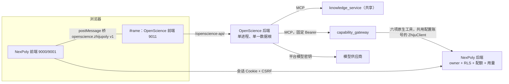
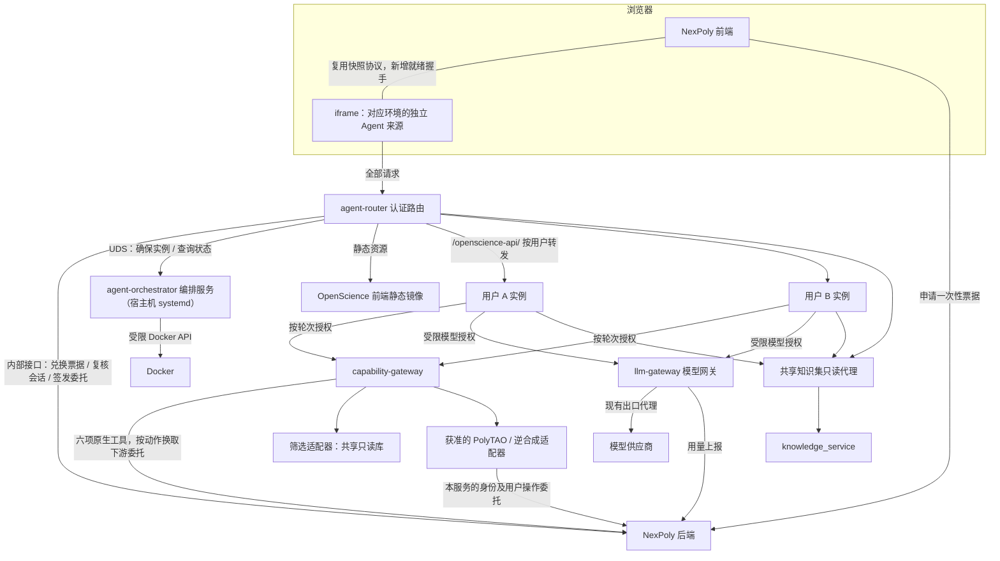
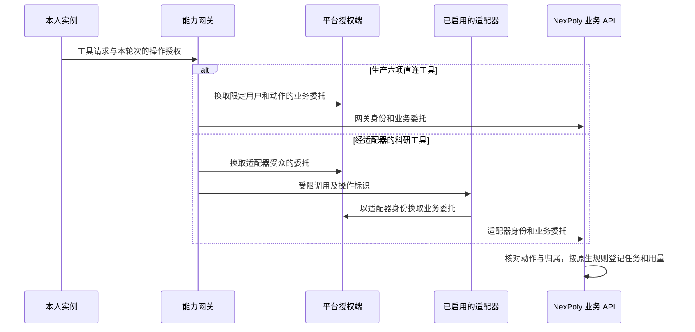

# OpenScience 每用户独立实例：规划与开发方案

> 修订日期：2026-11-19（北京时间） · 原草案：`b231790` · NexPoly 源码基线：`2a7de60` · 状态：**M4 已完成独立开发双账号的本地模型用量、私有文档检索与引用隔离验收**
>
> 本方案按“环境 + NexPoly 用户”分配持久工作区和独立 OpenScience 后端。11 月 19 日 15:07 的只读快照记录了当时的部署。随后在独立开发容器实测两个后端并发启动和普通、项目对话。M1 进一步验证了按环境和用户绑定实例、UID 和私有卷，以及两个同名项目在重启、回收和模板切换后的恢复。M2 在同一组保留卷上接入 NexPoly 网页登录、一次性票据和按用户路由，实测了切号、逐设备退出、名单撤权及校验服务中断。M3 在相同工作区逐项核对生产同版网关六项工具的任务、结果、用量和 DFT 下载。两个开发适配器也已完成双向草稿、任务、结果、用量、人工确认、回执恢复和独立限流验收。M4 沿用两个测试账号及其工作区，经网页登录后在独立开发库核对本地模型 token、私有文档和引用原文。磁盘硬配额与更高并发档位待后续验收。生产 9011 的切换另行发布。[M0 测量](verification/openscience-m0-20261119.md) · [M1 开发验收](verification/openscience-m1-20261119.md) · [M2 浏览器验收](verification/openscience-m2-20261119.md) · [M3 六工具对账](verification/openscience-m3-20261119.md) · [M3 开发适配器验收](verification/openscience-m3-adapters-20261119.md) · [M4 模型及知识验收](verification/openscience-m4-20261119.md)

## 0. 摘要

| 项目 | 结论 |
|---|---|
| 目标 | 每个 NexPoly 会员使用自己的 OpenScience 后端实例；会话、项目、文件、工具执行和下游 NexPoly 业务调用都归属真实用户，退出、禁用和改密后联动失效。 |
| 可行性 | 现有主机已在独立开发入口验证 A、B 两个账号的登录、私有工作区和撤权。扩到 5 人、20 个活跃实例分别需要第 7–9 节的容量证据和验收；50–100 个实例尚无真实镜像并发实测。 |
| 上线约束 | 生产六项工具共用登录身份；知识服务使用固定所有者；`/data` 可用约 169 GiB，尚无已验证的用户硬配额。每项开放的功能必须有归属和容量证据。 |
| 工作量 | 独立开发双账号闭环（M0–M2）约 5.5–8 人周，已计入全案 15–21 人周（75–105 人日）。两名熟悉系统的工程师约需 10–14 个日历周，含至少 9 个工作日的分阶段观察。见第 8 节的假设和依赖。 |
| 首批范围 | 独立环境已验证项目、普通对话、附件、实时事件、退出和恢复，以及六个原生工具和两个开发适配器的逐用户归属。后续试点按工具单独放行。 |
| 不做的事 | 不迁移、不自动认领 9011 共享实例中的历史会话；首期不向普通用户开放 shell/命令类工具。 |

## 1. 背景与现状

### 1.1 当前集成方式

| 层面 | 现状 | 依据 |
|---|---|---|
| 入口 | 生产 9000 与开发 9001 共用同一个 9011；网络层只有源 IP 白名单 | [deployment.md](deployment.md)、[public-ingress-security.md](public-ingress-security.md) |
| 权限判断 | 仅 NexPoly 前端根据 `openscience.use` 决定是否挂载 iframe；9011 不校验身份 | [App.tsx](../frontend/src/App.tsx) 第 122 行 |
| 消息桥 | 只校验 origin 与 source，传 directory / sessionID，不含用户 | [openScienceProjectBridge.ts](../frontend/src/lib/openScienceProjectBridge.ts) |
| OpenScience 数据 | 单租户：一个项目根、一个普通工作区、一份记录和配置（含模型密钥） | [openscience_mcp_dev.py](../scripts/openscience_mcp_dev.py) 第 365 行起 |
| 生产工具 | 9011 网关 `91f5d81` 的 `src/mcp.ts` 与 `src/zhiju-client.ts` 显示六项工具共用配置账号及登录会话：性质预测、单体聚合、DFT 提交、状态、列表、结果 | [原生工具清单](../scripts/openscience_mcp_dev.py) |
| 开发工具 | 19111 的筛选 MCP 使用共享只读底库；PolyTAO 和逆合成适配器各依赖预配置账号。其参数板、提交回执与生产直连网关属于不同调用路径 | [开发网关](polytao-capability-gateway-dev.md)、[逆合成适配器](retrosynthesis-mcp.md) |
| 知识库 | 运行镜像 `7840bcd` 的 `src/service.ts` 使用固定服务凭据，创建知识库时写入 `LOCAL_OWNER`；网页与 MCP 均需纳入权限范围 | [现有知识库接入](openscience-property-filter-mcp-dev.md) |
| 用量与权益 | 用量目录注明“尚未接入可验证的 owner 与 usage”；权益为 `external` | [usage_catalog.py](../backend/app/usage_catalog.py) 第 202 行 |
| 已有定位 | “登录后的 OpenScience 继续保持已确认的共享服务例外” | [user-isolation.md](user-isolation.md) |

### 1.2 本方案要关闭的缺口

| 编号 | 缺口 | 本方案的处理 |
|---|---|---|
| G1 | 9011 独立入口未验证 NexPoly 用户 | 先验证独立认证入口；未来切换生产时收回会员访问旧服务的路径，用写保护快照留档 |
| G2 | 所有会员共享同一份会话和项目列表，可互相重命名或删除 | 每用户独立实例和独立数据卷 |
| G3 | 工具在同一系统账号、同一数据根下执行 | 每用户独立容器、独立 UID、最小挂载 |
| G4 | 下游 NexPoly 调用都记在一个账号上 | 按用户委托令牌，RLS、配额、权益、用量对真实用户生效 |
| G5 | 同主机不同端口可能收到相同的主机 Cookie | 路由消费本环境的 Agent Cookie，对上游按允许清单重建请求头 |
| G6 | 切换账号后 Agent 来源的草稿或旧标签仍可能持有上一会话状态 | 清理本地数据、校验当前页面会话上下文，丢弃旧交换响应和旧订阅 |
| G7 | 模型密钥在 OpenScience 配置内、费用无法按人统计 | 模型网关持有供应商密钥，按发起轮次的用户委托执行预算预留及结算 |

## 2. 目标与非目标

**目标**

1. 会员只能看到、打开、修改自己的 OpenScience 会话、项目和文件；直接调用 API 或猜测会话 ID 也不能越权。
2. 不经 NexPoly 认证无法使用 Agent；退出、禁用、改密后 30 秒内切断访问，包括已建立的长连接。
3. Agent 发起的 NexPoly 业务调用以真实用户身份执行，走现有 RLS、启动授权、权益和用量记录。
4. 模型调用按用户计量，并支持每用户预算和并发限制。
5. 资源有上限：全局实例数、每实例内存/CPU/进程数、每用户磁盘配额；空闲实例自动回收。
6. 两个账号分别跨设备恢复自己的历史。一次登录退出后，同账号的其他有效登录继续可用；禁用和改密撤销其全部旧登录。开发/生产身份、存储和签发方独立。
7. 复用项目与会话快照协议，真实静态 UI 的票据交换、刷新和跨标签切号按第 9 节验收。

**非目标（本期不做）**

- 生产首期可开放的共享知识集须取得明确只读授权。独立开发按本次扩展范围提供 UTF-8 私有文本上传、检索、引用和下载。生产私人知识库的开放及运维另行评审。
- 首期不向普通用户开放 shell、终端、命令类工具；架构上为后续开放预留条件（第 6 节）。
- 不迁移 9011 共享实例的历史会话，不做“认领”。
- 不做多机调度和高可用；单机容量不足时另立项（第 11 节）。
- 沿用 NexPoly 登录、会话撤销和 RLS；为受信服务增加范围受限的委托认证。

## 3. 总体架构

### 3.1 目标拓扑

### 3.2 组件清单

| 组件 | 形态 | 职责 | 新增/改造 |
|---|---|---|---|
| NexPoly 后端 | 现有 FastAPI | 签发票据和委托令牌、复核会话、接收用量、委托身份认证 | 改造 |
| NexPoly 前端 | 现有 React | 换票、父页最终导航、切号和迟到响应处理、容量与授权状态展示 | 改造 |
| `agent-router` | M2 使用独立 Node.js HTTPS 流式代理 | 票据兑换、Agent 会话 Cookie、按用户转发、长连接撤销、删除 NexPoly Cookie、托管前端静态资源 | 新增 |
| `agent-orchestrator` | 新宿主机 systemd 服务，UDS 接口 | 按固定模板创建/启动/停止实例、分配 UID、空闲回收、全局容量 | 新增 |
| OpenScience 实例镜像 | 由已核验后端基础镜像派生 | 现有开发边界补丁、结构化结果补丁、服务端认证补丁 | 派生 |
| OpenScience 前端 | 现有已核验静态镜像 | 只提供静态资源，不再代理 API | 复用 |
| `capability-gateway` | 版本可复现的网关源码或派生镜像 | 为生产直连工具和获准的 MCP 调用取得逐跳委托，按用户及全局限流 | 改造 |
| 共享知识集只读代理 | 路由中的受控适配或独立服务 | 对网页与 MCP 限定同一组数据集和只读操作；知识服务凭据由代理保管 | 新增 |
| MCP 适配器 | 现有 Python 服务 | 用委托身份替换固定账号会话 | 改造 |
| `llm-gateway` | 新薄代理（或评估 LiteLLM，见第 12 节） | 持有真实模型密钥、校验虚拟密钥、计量 token、执行预算 | 新增 |

### 3.3 入口与来源规划

- **先在独立开发入口接入。** 使用独立的路由、签票方、浏览器来源、数据根和网络；在同站异源的测试父页上以真实静态包验收。生产是否沿用 9011 在灰度发布时决定。不同端口不隔离主机 Cookie，两个环境需使用独立主机名或已验证的等效隔离设计。
- **发布合同同步调整。** 现有 UI 依赖 `document.referrer` 识别父页，且 UI 镜像还代理兼容路径 `/api/`。在适配最终导航、来源白名单、受控 API 路由以及匿名/认证健康检查后，重跑侧栏与缓存回归。[父页合同](deployment.md) · [发布脚本](../scripts/openscience_ui_release.py)
- **Agent 来源必须与 NexPoly 同站（same-site）**：
  - 现在两者是同一 IP 的不同端口，属于同站；
  - 以后改用域名时，两者必须在同一可注册域名下（例如 `nexpoly.example.com` 与 `agent.example.com`）；
  - 否则 iframe 内设置的 Cookie 会被浏览器当作第三方 Cookie 拦截。
- **不能把 Agent 挂到 NexPoly 同一来源的路径下**：同源 iframe 可以读取父页面内存中的 CSRF 令牌（见 [user-auth-and-isolation-analysis.md](user-auth-and-isolation-analysis.md) 第 10 节）。
- **改用 HTTPS 时**：NexPoly 与 Agent 必须同时切换，否则 HTTP iframe 会被当作混合内容拦截（[deployment.md](deployment.md)）。

## 4. 关键流程

### 4.1 身份交接（一次性票据）

| 对象 | 归属与有效期 |
|---|---|
| 工作区 | 按部署环境和 NexPoly `user_id` 建立。账号的两台设备进入同一工作区，重启和重新登录后保留项目、对话和文件。 |
| 浏览器访问 | 每个 Agent 会话绑定签票的 NexPoly 登录会话、环境和 Agent 来源。每个已加载页面持有与该次交接绑定的上下文标识。 |
| 一次 Agent 操作 | 每个轮次、工具调用和人工确认绑定发起它的有效登录、工作区、会话和允许动作。同一工作区内的其他登录独立授权。 |

1. 父页持当前会话上下文与 CSRF，经 `POST /api/v1/openscience/workspace-ticket` 领取 60 秒单次票据。后端检查会员资格、`openscience.use`、当前环境总开关与试点名单。票据记录包含授权来源和一次性交接标识，仅持久化票据摘要。
2. 父页用定向表单向 iframe 的交换端点 POST 票据。路由确认父页来源与环境，后端在同一事务内复核会话、能力、有效期并消耗票据。路由按已验证身份调用 `ensure`，设置本环境专用的 Agent 会话 Cookie（HttpOnly、host-only、SameSite=Lax；HTTPS 下使用 Secure）。
3. Agent 过渡页按第 5.10 节处理旧身份数据，实例就绪后向父页发一次就绪消息。父页核对来源、iframe 窗口、当前登录代次和交接标识，再**由父页导航**到最终工作台，使现有 UI 能从 `document.referrer` 识别父页。超时、迟到响应和切号后旧消息均结束该次交接。
4. 票据只在请求体中传输。交换须与父页的登录代次对应；M2 按原登录的创建时间检查交换顺序，每个页面使用独立命名的 Cookie，迟到的旧登录响应无法覆盖新登录。每个工作台文档在开始私人 API 请求前取得页面会话上下文，路由同时核对该上下文和 Cookie。真实前端的普通请求、附件与事件流需逐类接入；M2 使用固定版本 UI 验证。切号后，旧标签页即使收到新 Cookie，其旧页面上下文也不能代表新账号。

### 4.2 请求路由与会话复核

- 路由从已验证的 Agent 会话取得环境、用户和工作区。实例地址由服务端映射。写操作核对来源和防伪造令牌；所有私有读取、下载和事件订阅都校验当前页面上下文。私人响应使用 `no-store`。
- 权威会话校验给出统一截止时间，最长为上次成功验证后 30 秒，且受会话过期时间约束。路由、网关和适配器传递同一截止时间，缓存命中不能续期。撤销通知可提前失效；权威服务不可用且超过截止时间时拒绝新私人操作，并主动关闭正在传送私有数据的连接。记录拒绝原因以区分撤销、失权和上游不可用。
- SSE 关闭缓冲，连接登记原登录会话，复核到期前续验，失效后断开，重连重走鉴权。转发请求按允许清单重建头，仅由路由加入实例认证和已校验上下文。日志保留请求 ID、路径模板、状态、耗时和审计主体，隐藏 Cookie、令牌、查询中的上下文、请求体和工具结果。

### 4.3 实例生命周期

1. 编排器按 `(environment, user_id)` 串行建立或恢复工作区，在全局容量预留成功后启动唯一实例。相同用户的并发请求复用正在启动的实例；启动失败释放预留并保留数据。过渡页等待就绪，30 秒超时可重试；容量不足返回 503 `workspace_capacity`。
2. 回收条件包括 30 分钟无业务活动、所有工作目录均无运行轮次/重试/待审批、无未完成工具调用或待落盘回执。被动 SSE 订阅、心跳和状态轮询不延长空闲期限。当前 `/session/status` 基于目录级 `Instance`；模板需汇总普通工作区和所有活动项目。状态未知时保留实例并报警。
3. 停止前锁住实例、进入排空状态，再次核对业务计数；期间的新请求等待或重试。已启动的科研任务按原任务 ID 和 owner 查询，回执可恢复后才释放关联操作。停止运行进程并撤销其凭据，私人卷保留。异常退出后由编排器协调恢复，不自动重做有副作用的调用。
4. 重启后由编排器核对持久工作区映射、容器标签、卷归属和资源预留，再允许 `ensure`。模板升级按同样的排空和重建流程进行。连续异常启动限次退避并报警。

### 4.4 工具调用身份透传

实例的工作区凭据用于确认该实例的环境、归属和代次；涉及私人数据、模型预算或有副作用的操作必须另有发起登录授予的操作权限。将操作标识从路由随可信请求交给实例，绑定到服务端轮次、会话和工具调用。异步回调与重试恢复该操作上下文。当前静态 `{file:…}` 挂载只适合承载实例身份，M3 需要验证两设备交错调用、重新授权和凭据轮换。

| 调用 | 校验和记录 |
|---|---|
| 实例 → 能力网关、模型网关或知识代理 | 各服务只接受发给自己的凭据，同时校验原始登录是否仍有效以及本次操作的范围。共享知识集的只读范围见第 5.8 节。 |
| 能力网关 → NexPoly，或经 MCP → NexPoly | 调用方用独立服务身份向授权端换取下一跳短时委托。受众、服务、动作、工作区、登录与操作引用全部绑定；每跳缩小授权，NexPoly 从有效委托恢复用户上下文。生产六项直连工具与开发 MCP 两路都要验收。 |
| 参数板 → 人工确认 | 路由从当前用户操作取得确认，验证会话中受信工具产生的草稿、修订和动作权限，再用独立确认身份提交。记录 owner、草稿、稳定幂等键和业务任务 ID；提交后回执丢失时恢复原结果。 |

操作委托独立于工作区存续，生命周期不超过发起登录和允许动作所需时间。换票、续签、结果查询与下载均在服务端核验归属。每个已接受业务任务沿用平台现有开始授权、配额和权益规则。审批、任务提交或凭据更换失联时，以服务端可恢复的操作记录为准。

### 4.5 退出、禁用、改密联动

| 事件 | 浏览器、委托和实例的处理 |
|---|---|
| 单台设备退出 | 撤销该登录、其 Agent 会话和操作授权，30 秒内断开对应私有流；该用户其他有效登录继续使用同一工作区及自己的授权。最后一次有效登录结束后，按任务收尾与回收规则停实例。 |
| 改密或禁用 | 同一事务撤销该用户全部登录及派生授权，拒绝新操作、断开私有流。持久文件按原 owner 保存。已授权开始的 GPU 作业遵守既有收尾与额度释放语义。 |
| 失去能力、移出试点名单、环境总开关关闭 | 签票、兑换、持续校验和下游授权同时执行最新策略，30 秒内结束受影响的访问；只影响对应环境及用户。 |

## 5. 详细设计

### 5.1 NexPoly 后端

M2 的独立账号库在 0026 基线上另装 `openscience_m2` 开发 schema，两个迁移文件仅由开发启动器执行。生产计划在 `0026_monomer_retrosynthesis_jobs` 后追加迁移，候选编号 `0027_openscience_agent`，实施时按[迁移治理规则](postgres-migration-governance.md)核对最新台账。票据、Agent 会话与委托记录均保存环境和 owner；票据记录签发登录与消耗时间，Agent 会话记录来源、有效期与撤销时间，委托记录原始登录、操作、父授权、受众、动作和到期时间。随机令牌持久化摘要。按 API、认证、内部兑换/撤销和审计职责授予最小权限，配套 RLS、过期清理和恢复测试。

| 接口 | 权限及结果 |
|---|---|
| `POST /api/v1/openscience/workspace-ticket` | 当前登录、CSRF、会话上下文、会员能力、环境总开关与按人名单全部通过后返回票据与固定环境的交换地址。 |
| `/internal/openscience/tickets/redeem`、`sessions/validate` | 路由以自身服务身份兑换票据、复核原登录和当前策略，取得带截止时间的授权结果。 |
| `/internal/openscience/delegations`、`delegations/introspect` | 路由申请操作授权，授权端据原登录签发；获准的服务交换下游委托，接收服务根据自身身份校验受众与范围。认证失败或下游身份不匹配时拒绝。 |
| `/internal/openscience/usage` | 模型网关按稳定请求 ID 和 owner 幂等上报预留、结算或待核对记录。 |

[现有能力策略](../backend/app/auth/policy.py)把 `openscience.use` 赋给所有会员，生产账号部署配置中的 [`USAGE_ENTITLEMENTS_ENABLED`](../docker-compose.prod-accounts.yml) 默认为关闭。Agent 灰度需独立的环境开关和用户试点名单，默认关闭，能够单独回收 Agent 权限。生产和开发各自签发、复核与撤销。改密、禁用和退出与 Agent 派生记录在同一事务中失效。

[认证中间件](../backend/app/auth/middleware.py)增加受限的服务调用方式。业务端同时校验服务凭据、受众为本业务端的操作委托、允许的 HTTP 方法/资源动作，随后走同一套 owner、RLS、启动授权、权益和用量逻辑。草稿归属、重试幂等键和结果读取都包含真实 owner。原生科研工具按原模块记录，并标明 OpenScience 来源；模型 token 与实例运行时间另列，避免重复计入同一消耗。

### 5.2 agent-router（认证路由）

M2 开发实现采用 Node.js HTTPS 流式代理，按页跟踪进行中的请求和 SSE，通过用户专属 Unix socket 连接后端。浏览器使用 11 月静态 UI，容量阶段再核验并发连接数。路由私有网络只连授权端、编排服务和需要的上游。配置按环境固定浏览器来源、票据签发者和工作区映射。

| 入口 | 路由行为 |
|---|---|
| `/_nexpoly/auth/exchange`、`/_nexpoly/status` | 核验票据、页面上下文，处理就绪或容量状态。 |
| `/openscience-api/*`、现行 UI 使用的 `/api/*` | 按允许的方法和功能转发至本人实例；未纳入首版的 API 明确拒绝。人工确认调用单独授权。 |
| `/knowledge-api/*` | `dev-m1` 服务按原登录提供私有文档上传、读取和检索。网页与只读 MCP 使用同一套所有者权限。生产共享集按批准名单开放。 |
| 静态文件和前端导航 | 仅服务当前固定版本的静态文件与明确的 SPA 路由。现行 UI 镜像自身包含 API 反向代理，必须移除或绕开这些配置；未知服务路由返回错误。 |

转发时按业务需要传递内容类型等允许头，服务端重建上游认证；浏览器 `Cookie`、`Authorization`、客户端声称的用户或实例身份不透传。生产平台实际 Cookie 名为 [`nexpoly_prod_http_session`](../docker-compose.prod-accounts.yml)，开发名可配置。禁止上游响应设置路由或平台会话；固定嵌入来源，限制请求体，拒绝非预期重定向。部署身份与生产端口切换在各自里程碑单独验证。

### 5.3 agent-orchestrator（编排服务）

宿主 systemd 服务经受限 Docker 接口按固定模板创建容器。路由只经受文件权限控制的 UDS 提交 `ensure`、`status`、`stop` 等受限操作。部署环境来自可信配置，镜像、命令、挂载、地址和配额由模板决定。服务持久记录工作区、固定 UID/GID、模板版本、容器代次和运行预留，启动时按第 4.3 节核对容器与文件归属。全部实例合计执行环境总内存、磁盘和数量约束，见第 7 节；容量不足时保持现有用户可用。管理命令提供状态、排空、停止和审计。

M1 已实现开发专用的本地管理器、Unix socket 入口及空闲巡查。一个持久注册表支持多个开发环境，绑定稳定 UID/GID、独占卷和容器代次。当前仅支持独立回环模型和本地可信调用方。M2 已经通过认证路由接入这套管理器，后端仍无宿主发布端口。[M1 操作与重放](verification/openscience-m1-20261119.md#开发重放)

### 5.4 实例镜像与配置模板

11 月 19 日下午核对的 9011 后端为 `53293fc-release-20261119`，UI 为 `9e342b5-production-dual`。仓库[补丁](../ops/openscience-mcp-dev/patch.mjs)固定 10 月基底和精确源码哈希，实际后端的 `prompt.ts` 已变化。本轮 M0 已按摘要固定基底，在独立环境构建 11 月带补丁候选并实测双实例。原 19111 模板仍锁定 10 月基底。M1 新增[独立开发模板](../ops/openscience-per-user-dev/Dockerfile)，固定 11 月基底并验证了附件、持久对话和私有卷恢复。真实模型和科研工具归属按 M3/M4 验收。[构建与测量记录](verification/openscience-m0-20261119.md)

1. 在固定版本上验证实例入口认证、配置脱敏与业务路由清单。首期开放普通/项目对话、私人工作区文件和验收过的工具。终端、任意命令、配置更改及额外代理入口默认关闭；保留服务端会话绑定、结构化结果和回执规则。
2. 实例使用专用 UID/GID、无宿主业务端口、只读根文件系统，移除 capabilities，仅挂载本人文件、记录及运行所需可写目录。测试候选值为 2 GiB 上限、1 vCPU、256 PID、64 MiB 临时文件系统；整机预算与阶段上限见第 7 节。
3. 配置模板按版本只读共享。每个受众接收独立的实例认证，按轮次另行授权；实例密钥可轮换，旧代次在受控排空后撤销。真实模型密钥、网关共享凭据和人工确认身份只在相应服务保存。M0 已在只读根文件系统和独占卷上验证后端启动和消息落盘。合成凭据文件替换后，已打开目录继续读取旧值，新目录与新进程读取新值。旧连接和旧授权失效须在路由及下游另行验证；就绪信号与跨工作目录的业务活动汇总分别提供。

### 5.5 存储与配额

每个环境使用独立数据根。编排服务为 `(environment, user_id)` 分配稳定 UID 和私有目录。每个实例只挂载本人的普通工作区、项目、消息记录、可写状态和缓存；配置模板只读共享，临时凭据单独挂载。停止实例保留数据；恢复时重新签发凭据。

- **硬配额与卷容量**。每人 2 GB 是待验证的试点上限，覆盖附件、记录和所有可持久写入路径。11 月 19 日目标盘 `/data` 为 ext4，挂载参数为 `rw,relatime`，尚无已验证的项目配额。选择能执行硬配额的卷或按用户封顶的存储，实测本人到限仍可读取、删除和释放空间，另一账号仍能写入。小时统计用于预警，不能据此通过硬配额验收。
- **保留与恢复**。会话由用户管理，账号删除沿用平台的科研资产保留原则。按用户备份数据与所有权映射，记录模板版本；在隔离目录恢复两个同名项目，核对用户、UID、附件和任务引用。备份、日志、临时文件与宿主其他业务分别预算，见第 7 节。

### 5.6 网络隔离

| 网络路径 | 目标策略 |
|---|---|
| 路由 → 用户实例 | 只向编排服务解析出的本人实例转发，实例校验路由身份 |
| 实例 → 内部服务 | 仅到能力网关、模型网关、受控的只读知识检索入口；各自校验受众与操作权限 |
| 实例 → 其他实例、宿主机管理服务、NexPoly 后端、数据库或公网 | 拒绝；各业务网关分别管理获准的上游出口 |
| 开发环境 ↔ 生产环境 | 网络、身份签发和数据根分开，任何环境的票据和服务凭据仅对本环境有效 |

独立实例不发布宿主端口。共用内部网桥时，需在独立开发环境验证同桥隔离和宿主服务边界，覆盖实例创建、删除及地址重新分配。11 月 19 日现场未见预期的桥接过滤系统项；现有公网白名单处理的是入站流量。若同桥规则无法稳定执行，改用每用户隔离网络或经验证的等价隔离方式。保留新建实例的默认拒绝策略和实例级身份校验。 [公网入口防火墙](../scripts/public_ingress_firewall.py)

### 5.7 生产能力网关与工具归属

生产网关镜像 `91f5d81` 的 `src/mcp.ts` 和 `src/zhiju-client.ts` 显示，六个现有工具共用一个通过配置账号登录的 `ZhijuClient`，直接调用 NexPoly。19111 的 PolyTAO、逆合成等 MCP 适配器属于另一路径。M3 已从 M0 核对过的本地 11 月镜像离线派生候选，构建时校验镜像和九个源码、依赖清单及锁文件的摘要，保留原六项工具的协议。生产发布所需的长期源码维护责任仍见 D2。 [开发网关接入范围](polytao-capability-gateway-dev.md)

| 生产工具（共六项） | 改造和验收 |
|---|---|
| 性质预测、单体聚合 | 网关依据发起轮次的真实用户，以对应业务模块执行权益、准入和用量检查；A 和 B 的调用分别落入本人用量，同一调用不重复计数 |
| DFT 提交 | 保留现有审批和启动授权；服务端把用户、会话、已确认的操作和幂等键绑定。用测试执行器确认 A 的提交只生成 A 的一条任务，重试返回原任务 |
| DFT 状态、列表、结果 | 三项都使用当前访问者的授权。A 换设备后仍能列出、续查同一任务并取回结果；B 在列表、详情、结果和后续产物下载中均取不到 A 的数据 |

实例凭据标识环境与工作区。每轮调用还需与平台登录会话关联的短时操作授权。能力网关校验自身受众后，直连路径换取面向指定 NexPoly 业务接口的授权；经 MCP 路径先换取面向指定适配器的授权，再由适配器凭自身服务身份换取业务授权。逐跳保留环境、用户、源会话、操作及可追踪的请求标识，收窄工具和资源范围；下游到期时间及撤权截止继承自原授权。业务端按可信用户建立现有 RLS、任务准入和计量上下文，不能由模型或浏览器填写 owner。

2026-11-19 的开发验收复用了 `dev-m1` 的两个账号、原 UID 和私有卷。两人各在自己的对话中调通六项工具。预测、聚合和 DFT 提交分别按原用户结算一次，六次丢失回执后的重复投递均取回原结果或任务。两人的列表、状态、结果和实际下载双向核对通过，另一账号访问状态、结果、单文件和 ZIP 均收到原生 404。DFT 使用本地 CPU 测试执行器验证任务归属和产物访问，科学数值与 GPU 性能另行验证。[逐工具验收及复测命令](verification/openscience-m3-20261119.md)

### 5.8 开发 MCP、人工确认与知识服务

| 接入项 | 现状与上线条件 |
|---|---|
| PolyTAO、逆合成 | `dev-m1` 的逐用户模式已通过验收。适配器凭自身服务身份，按当前登录、草稿与修订版取得受限业务授权；模型只能准备和读取，人工确认由准备该草稿的登录完成。接受后丢失回执按原幂等键恢复，本人再次确认不重复执行或计量。限流按适配器和用户统计。原 19111 配置和生产放行另行管理。[A/B 验收](verification/openscience-m3-adapters-20261119.md) |
| 数据库筛选 | 对明确允许共享的只读底库保留共享读取，查询和用量归当前用户。每用户限流叠加客户端与全局上限；上游当前按客户端限制每分钟最多 60 次、最多 2 并发，提高上限须先验证容量。[上游限制](../backend/app/mcp_security.py) |
| 知识网页与知识 MCP | 现场知识镜像 `7840bcd` 使用固定 `LOCAL_OWNER`。开发试点使用独立 PostgreSQL 所有者索引，按原登录验证私有文档上传、下载、检索、分段引文和原文回读。网页和只读 MCP 共用同一检索函数及行级策略。当前没有获准的共享知识集，生产共享名单及私人文档开放另行确认。[开发双账号验收](verification/openscience-m4-20261119.md) |

### 5.9 llm-gateway（模型网关）

开发候选通过每个用户工作区的私有 Unix socket 接入离线 Qwen2.5-7B。服务端按工作区代次、发起登录和对话轮次计量，独立账本记录实际 token 与待核对预留。外部供应商出口、费用与生产预算仍需取得相应证据。[开发验收及复测](verification/openscience-m4-20261119.md)

- **协议与出口。** 同时支持流式 Chat Completions、Responses。模型的上游目标和凭据由网关固定配置，实例只取得本人轮次的模型调用授权。按 provider 区分现有受限 HTTPS 隧道与 DeepSeek 的独立 HTTP 出口，分别核验流式回复、取消与用量字段。[现有出口](openscience-property-filter-mcp-dev.md) · [Responses 配置](../ops/config/openscience-luna-responses.merge.json)
- **预算与并发。** 转发前按用户、日期和请求 ID 原子预留经核验的输入及允许的最大输出用量，计入所有在途请求，再执行用户和全局并发限制。预算或并发已满时返回可重试状态。工具模型调用、辅助标题等各次实际供应商请求均应有独立记录。
- **结算。** 正常结束按供应商返回的 token 结算并释放余量；断流、超时或缺失 usage 标记“未知/待核对”，保留有界的保守预留和对账记录。重试、迟到回执按原请求幂等处理，估算与真实 token 分列。普通科学任务沿用原生模块计量并记录 Agent 来源，Agent 模型 token 与实例时长单列，避免同笔用量重复归集。

### 5.10 NexPoly 前端

交换页按第 4 节完成一次性票据兑换。现有 UI 从 `document.referrer` 识别父页面。交换页就绪后以校验来源与窗口的消息通知 NexPoly，由父页发起最终 iframe 导航，再请求本人项目和会话快照。用实际静态包验证首次进入、刷新、从项目返回普通对话及两个环境的父页。 [父页识别约定](deployment.md) · [工作区导航](../frontend/src/App.tsx)

切换身份时卸载 iframe、取消在途请求、断开旧订阅并清空两类侧栏快照。交换页清理 Agent 来源的旧用户浏览器数据后方可进入；不同账号、标签页和迟到的票据响应按环境与会话代次丢弃。签票及持续复核共同执行试点名单和总开关，客户端呈现未获准、实例启动中、容量不足和可重试状态。 [现有入口](../frontend/src/components/AgentWorkspaceHomePage.tsx)

### 5.11 观测与审计

记录每个环境的运行、启动与空闲实例数，工作集及容器内存峰值，磁盘配额和全盘余量，OOM、回收耗时、冷启动 P50/P95、容量拒绝，以及模型与业务工具的耗时、限流和用量。用服务端请求 ID 关联原始登录、操作、人工确认、原生任务、模型结算与撤权结果；审计记录受控保存，指标只保留必要聚合。监控不采集提示词、回复、附件、Cookie 或委托令牌。

## 6. 安全设计要点

| 边界 | 验收依据 |
|---|---|
| 浏览器到路由 | 直接访问和失效票据无法进入私人工作区。写操作校验来源及当前会话；上游请求头按白名单重建，静态兜底不代理旧 API |
| 用户到实例 | 每个实例仅挂载本环境、本人的数据。路由按服务端映射寻址。两个合成用户的文件、项目、会话、事件及重启后恢复记录分别归属本人 |
| 实例到工具 | 核对本人的操作授权、受众和服务身份。模型身份没有人工确认权限，实例不持有供应商密钥和共享网关凭据 |
| 撤权与后台任务 | 自登录撤销或权限收回起 30 秒内拒绝新请求并断开旧流，复核失联沿用同一截止；已获启动授权的科研任务按原生规则收尾，结果继续受 owner 约束 |
| 编排与容量 | 编排 UDS 只接受已定义动作；模板固定镜像、挂载与网络。实例及总量上限、可执行的磁盘配额、模型在途预算均需实测 |
| 后续命令工具 | 首期关闭终端和命令执行。后续若开放，单列运行时和出站隔离、最小挂载、seccomp 或更强沙箱及双账号验收 |

## 7. 容量规划与成本

### 7.1 已核实的环境与测量边界

以下为 **2026-11-19 约 15:07（北京时间）** 的只读快照。Docker 工作集反映采样时负载，配额来自运行容器；快照没有测量同时生成、冷启动风暴或工具拥塞。

| 对象 | 现场值 | 规划用途 |
|---|---|---|
| 宿主机 | 128 逻辑 CPU、约 251.5 GiB 内存，当时可用约 188 GiB；同机还运行数据库、开发环境和科研作业 | 可进行有限开发试点；宿主可用内存与预留给 Agent 的预算分开计算 |
| 生产 9011 后端 | 镜像标签 `53293fc-release-20261119`，工作集约 339 MiB，上限 8 GiB / 4 vCPU；UI `9e342b5` | 核对当期真实版本和静态 UI 兼容性 |
| 开发 19111 后端 | 工作集约 286 MiB，上限 2 GiB / 2 vCPU | 可参照其独立挂载方式，隔离试点另建数据根和实例 |
| 目标盘 `/data` | ext4，使用率 95%，普通可用空间约 169 GiB；尚未验证用户硬配额 | 将全盘余量、每用户写入和异盘备份纳入放量门槛 |
| 共享组件 | 静态 UI、按用户鉴权后的网关和授权共享的只读知识集可复用；科研任务复用原生队列 | 在后端实例之外单列网关内存、模型请求/token、GPU 队列与备份成本 |

开发资源限制见[现有 Compose](../docker-compose.openscience-mcp-dev.yml)。初版曾以 opencode 和本地假模型估量单实例资源；其 RSS、冷启动和每轮磁盘增长保留在[原草案记录](https://github.com/lzq390/ZhijuPoly/blob/b231790a50cf1d2e41c1ce640083b5debb2ba744/docs/openscience-per-user-instances-plan.md#L462-L478)中。新一轮准入按真实候选镜像的工作集、cgroup 峰值、宿主影响和实际可用空间确定。

11 月 19 日的独立实验为每个测试实例各配 1 vCPU、2 GiB 内存、独占的新卷和回环模型。每档三轮并发启动 A/B，最后一轮还同时执行普通及项目对话。冷启动、两个后端的同时段工作集峰值和清理证据见 [M0 实测报告](verification/openscience-m0-20261119.md)。

### 7.2 准入与扩容

| 项目 | 建议执行方式 | 放量前需要的证据 |
|---|---|---|
| 内存 | 每实例 2 GiB 为初始封顶值。设置所有实例的聚合限制、启动前预留与全局并发上限，同时给共享服务和宿主留余量 | 若 Agent 总预算为 32 GiB，即使忽略共享开销也只能完整承诺 16 份 2 GiB；20 份共 40 GiB。要支持 20 个同时活跃实例，须落实更高预算或降低并验证实例上限；若选择超配，另行评估并接受同时触顶的影响 |
| 磁盘 | 200 人 × 2 GB = 400 GB（约 373 GiB）。单用户封顶值可以超额分配，但现有 169 GiB 不能保证全部用满 | 验证硬配额、宿主最低可用空间与拒绝新增写入/实例的水位；按实测增长留足备份和恢复空间 |
| CPU、模型和工具 | 每实例 CPU 初值 1 vCPU，开发样本配置为 2 vCPU；同时执行每用户及全局工具并发、供应商请求/token 限额和原生 GPU 准入 | 记录真实候选的冷启动与流式首响应 P95、工具等待/拒绝、已启动作业收尾。筛选等适配器的每客户端限流不直接换算成活跃人数 |
| 并发档位 | 从独立开发环境双账号开始，运维、5 人、目标最多 20 个同时活跃实例逐档评价；注册人数与并发分开统计 | 每档验证代表性负载与超额拒绝，满足第 9 节才升档。30/50 个实例可在容量允许的隔离环境做探索压测；50–100 个活跃实例尚无实证 |

### 7.3 成本口径

开发与灰度工作量见第 8 节。运维成本包括固定镜像维护、网关、按用户增量数据、备份与恢复。模型费用按授权用户、模型和调用 ID 汇总，区分供应商确认用量、估算和未知用量；预算依据用合成负载以及获准的聚合指标校准。GPU 或外部计算开销按对应原生任务另计。

## 8. 里程碑与工期

按 1 人周 = 5 个工程人日估算，包含开发、联测及灰度期间的工程支持。双账号验证使用独立开发入口、两个合成会员、专用数据卷、候选镜像和测试模型。生产 9011 的现有路由与数据不参与该验证。

| 里程碑 | 交付范围 | 人周 | 完成条件 |
|---|---|---:|---|
| M0 基线与可重复环境 | 固定后端、UI、网关和知识服务版本；核对补丁锚点、兼容路由、模型出口、工具清单；选定开发数据盘与资源预算 | 1–1.5 | 输出版本、容量与差异清单；用真实候选镜像记录基线和冷启动；明确共享知识集及首批开放的工具。 |
| M1 实例与存储 | 按环境和用户绑定数据卷、UID、网络和模板；按需启停；区分被动订阅和活跃任务；故障恢复 | 2–3 | 两个用户的数据挂载互斥；实例重启、空闲回收和新模板启动后都能恢复原主人的合成数据。 |
| M2 身份与浏览器 | 票据、路由、注销传播、灰度开关；父页驱动导航；跨标签与跨设备身份切换；全部浏览器入口 | 2.5–3.5 | 通过第 9 节开发双账号验收，留存侧栏、实时流、重启恢复和撤权时延记录。 |
| M3 工具归属 | 优先完成生产网关六项工具的逐用户授权和原生计量；再接开发版 PolyTAO、逆合成的人工确认、幂等和回执恢复 | 4–5.5 | 六项生产工具逐项与 NexPoly 任务及用量核对；两个开发适配器在开发环境各自通过确认与恢复验收，生产开放清单单独登记。 |
| M4 模型与知识服务 | 独立开发模型授权、预算预留及断流结算，网页与只读 MCP 统一检索本人的私有文档 | 2–3 | 实际 token 逐登录、轮次及请求核对。覆盖在途预算、断流与结算重试。A/B 同名文档的命中、引用及原文均归本人。外部供应商与生产知识策略按发布目标另验。 |
| M5 容量、备份与观测 | 总内存与磁盘保护、容量准入、每用户硬配额、告警和异机或独立存储备份；按用户恢复演练 | 2–2.5 | 在目标介质验证满额拒写和恢复；测得拟开放并发的内存、冷启动、工具限流、磁盘及备份余量。 |
| M6 分阶段验收与灰度 | 运维验证、最多 5 名内部成员、经容量核定后最多 20 个同时活跃实例；验证关闭开关与保留数据 | 1.5–2 | 每个获准阶段都有第 9 节的技术证据和观察记录，回滚后私有数据仍可恢复。 |

先交付 M0–M2 的开发双账号闭环，累计 **5.5–8 人周**。M0 后 M1 与 M2 可并行。M3、M4 共用 M2 的身份和授权接口，可以并行；M5 的恢复及容量实测依赖 M1 的最终挂载方案。M3–M5 完成后进入 M6。全案约 **15–21 人周（75–105 人日）**，两名熟悉当前系统的工程师约 **10–14 个日历周**，含三段顺序进行、合计至少 **9 个工作日**的灰度观察。

M0–M4 已完成本文所列独立开发范围。M5、M6 的原估算合计 **3.5–4.5 人周**，涵盖容量、备份恢复与分阶段灰度。该数字仅适用于这两个阶段。外部模型供应商出口验证及私有知识服务的生产化，需要在存储、服务预算和开放范围确定后另估。

相比原估 12.5 人周，增量主要来自生产网关直连账号的替换、逐登录撤权、真实 UI 兼容、配额恢复和工具回执核对。估算以可维护的网关源码、可用的配额存储、已授权的开发工具额度为前提；后续按实际取得的依赖和并发测试结果重估。私人知识库、多机高可用、开放命令工具和存储采购周期另估。

## 9. 验收与测试

### 9.1 分阶段放行

开发双账号阶段已留存浏览器、事件流、撤权时延和实例恢复记录。独立开发环境已完成 AC-11 的六工具归属核对，以及 AC-12～13 的两个开发适配器确认、回执恢复与逐用户限流验证。[开发适配器](verification/openscience-m3-adapters-20261119.md) · [六个原生工具](verification/openscience-m3-20261119.md) · [M2 浏览器](verification/openscience-m2-20261119.md) · [M1 恢复](verification/openscience-m1-20261119.md)

登记环境、候选版本、功能清单和并发上限后逐阶段验收。同一套候选版本的观测和双向归属证据随阶段保存，避免把旧版本或其他环境的通过记录当成本轮结果。

| 阶段 | 测试边界 | 通过条件 |
|---|---|---|
| 开发双账号 | 独立开发来源（Cookie 与生产隔离）、账号库、数据卷和网关；A、B 分别创建同名项目和不同标记的对话、附件。每项可见性断言交换 A/B 再测一次 | 普通与项目内对话、文件、真实侧栏、事件流、重启前后的本人恢复均正确；完成双设备和旧标签页撤权；另一账号看不到标题、文件内容和事件。 |
| 开发工具与容量 | 用获准的测试任务走生产同版的六项工具及选定开发适配器；大规模并发使用同版镜像、合成输入、测试模型和受控工具替身 | AC-11 至 AC-18 及 AC-21 至 AC-23 中拟开放功能全部通过。分别核对平台已有任务和用量。按第 7 节容量预算完成目标并发的重复测量和恢复演练；超限按计划拒绝准入。 |
| 运维灰度 | 未来发布时仅运维名单可用；使用独立候选地址演练入口切换与回滚 | 连续至少 3 个工作日，签票与持续复核开关均生效，受控回滚可保留并恢复私人数据。全部强制场景通过，方可开放内部名单。 |
| 最多 5 名内部成员 | 仅开放前述已验收的工具、模型和知识集 | 连续至少 3 个工作日，完成每类工具的实际归属抽查；跨账号事件、重复提交、未解释的用量归属差异和 OOM 均为 0。达到经核定的资源或供应商上限时，新请求可控退回。 |
| 至多 20 个同时活跃实例 | 先按实测核定可容纳数，再设置实例准入上限；注册人数单独统计 | 在相同资源预算的独立环境下，目标并发至少完成两轮包含冷启动、活跃工具、空闲回收的完整测试；无 OOM，内存、磁盘和备份余量符合第 7 节，启动 P95 在配置的 30 秒就绪窗口内。扩到核定上限后再观察至少 3 个工作日并核对前一阶段指标。 |

未满足容量或功能条件时保留上一阶段上限；出现跨账号可见、撤权超时、重复提交或用户数据错误归属时关闭该环境的 Agent 入口，通知已连接的客户端并保留私人数据。修复后重做受影响的强制场景并重新观察。30/50 个实例仅是有额外容量后可选的开发压测档位。

### 9.2 双账号、工具与容量验收矩阵

测试记录保留候选摘要、阶段、合成账号代号、请求/任务关联标识、预期与实测结果，以及资源指标。用户对话、真实凭据和私有附件排除在发布报告之外。

| 编号 | 场景 | 可核对结果 |
|---|---|---|
| AC-01～03 | A/B 各自创建普通对话、同名项目、项目内对话和附件；分别打开、修改、归档或删除各自测试数据 | 本人列表、详情、侧栏和事件显示自己的标记；另一方的只读与变更操作被拒，且对方数据保持完整。刷新、重新登录和重新连流的结果一致。 |
| AC-04～05 | 候选的所有兼容 API 和静态入口；票据已消费、过期和迟到的交换结果 | 未授权会话只见入口提示；业务数据由已授权路由提供；票据仅兑现一次，迟到交换不能切换当前身份。 |
| AC-06、08 | A 在两台设备登录；仅退出其中一台；同一浏览器另一标签切为 B，恢复旧标签、断线重连 | 从撤销提交起至多 30 秒，退出设备的旧访问和事件流失效；A 的另一有效登录可继续操作，B 无 A 的草稿、快照、事件或迟到响应。 |
| AC-07、19 | 改密、禁用、移出名单、总开关关闭；校验服务中断 | 对应会话、工具、模型请求和旧流在同一 30 秒期限内停止获得新授权；已获启动授权的后台任务按原 owner 收尾。在认证不可用时也遵守该期限。 |
| AC-09～10 | 网络与接口隔离、实例私有挂载、实例凭据边界 | 仅本人数据可见、仅允许的服务可达；实例无法取得平台模型密钥、共享业务账号或人工确认凭据。 |
| AC-11 | 两个身份分别经生产同版网关执行六项工具：性质预测、单体聚合、DFT 提交、状态、列表、结果；覆盖实际开放的产物下载 | 每项均保留“调用方 → 平台用量/任务 → 所见结果”对账。A/B 使用各自的配额和身份；DFT 列表、状态、结果、下载及重新登录恢复均限本人，固定配置账号没有新任务或归属记录。 |
| AC-12～13 | 对 DFT 提交测试同一用户幂等重试和两用户同名请求；分别验证开发版 PolyTAO 与逆合成的草稿、人工确认、重复确认、回执丢失与恢复、每用户限流 | 重试关联原任务，每次有效确认至多新增一项任务；A/B 的任务、费用或用量分别归属本人；仅有模型回复不能完成确认。一人达到工具限流，另一人可继续使用其获准额度。 |
| AC-14 | 同一用户两条并发模型流、达到日预算、中途断流、提供方缺少 usage、结算重试 | 准入考虑已预留额度；释放或结算能与请求关联，估算单独标记；重试不重复计量。另一账号额度独立。 |
| AC-15 | 实例数、总内存或磁盘余量触达准入线，同时有新用户进入 | 新实例收到容量提示，既有实例和 NexPoly 作业保持可用；分别记录 cgroup 峰值、文件系统和备份余量、上游限流。20 个 2 GiB 上限的实例合计 40 GiB，32 GiB 总预算须以第 7 节的保护和准入规则执行。 |
| AC-16、18 | 空闲回收、项目中有活动工具或待确认操作、进程异常退出、升级、备份恢复 | 仅有被动订阅的实例可回收；忙碌实例不误停。重启或恢复后同一用户可找回原项目与会话，另一用户看不到恢复数据，已确认任务不重复提交。 |
| AC-17 | A 达到磁盘硬配额；数据盘达到全局预留线 | A 的新增写入受控拒绝，仍能查看和释放自己的空间；B 的卷及其他业务留有余量。恢复演练核对用户目录、UID 映射、额度和文件一致性。 |
| AC-20 | 未来发布演练中的旧共享存档和回滚 | 存档具备只读保护；收回 Agent 权限后，普通会员不会被导向共享历史。 |
| AC-21 | 知识服务页面与 MCP | 开发扩展要求 A、B 上传同名私有文档后，网页与 MCP 均仅命中本人内容，引用、文档下载均重新校验。生产首期仍须执行批准的共享只读集合名单，私有文档上线另行验收。 |
| AC-22 | 开发与生产身份边界、试点名单与全局关闭开关 | 用两个候选环境模拟开发和生产，同名用户获得各自的工作区；名单、撤权和关闭开关仅影响所选环境。 |
| AC-23 | 真实 UI 的消息桥、兼容路由和身份切换 | 两个允许的父页均能恢复本人侧栏；上游只收到该次操作所需的授权，普通站点凭据不进入实例。 |

### 9.3 验证分工

| 验证位置 | 纳入的证据 |
|---|---|
| `backend-tests`、`postgres-media-integration` | 独立 PostgreSQL 中的 RLS、会话撤销、任务 owner、权益和用量；对照 A 正常访问、B 拒绝和撤销后的结果 |
| `confirmed-mcp-adapter-tests` 及网关契约测试 | 逐跳身份、生产六工具的业务路由、开发工具的人工确认与回执恢复；用现有任务 ID 核对幂等 |
| `mcp-derived-images`、路由与编排测试 | 锚点与镜像构建、凭据边界、用户卷、被动订阅、容量准入与重启后资源恢复 |
| Playwright 及独立容量演练 | 用真实 UI 和两份浏览器上下文，另测同浏览器多标签与会话交换乱序；编排、备份和并发测试各用独立数据根与预算 |

现有[CI 工作流](../.github/workflows/ci.yml)提供部分基础。上述新增用例随对应里程碑接入；报告分别标明夹具测试、真实 UI 测试、候选工具链联测和现场指标，记录未通过项与复测结果。

## 10. 上线、历史数据与回滚

1. **独立候选**。M0 起使用独立开发来源、路由、网络、数据根和合成账号。生产 9011 保持现行服务。先验证受控测试模型和业务夹具，然后在独立环境走生产同构 DFT 链，再评估灰度。
2. **发布准备**。完成第 9 节指定阶段后，核实实际使用的发布控制器与端口。仓库保留的[UI 发布工具](../scripts/openscience_ui_release.py)使用 19011 作候选端口，并检查 9011 的健康状态；同步更新实际发布、健康检查和回退约定。生产切换另行安排。
3. **逐级放量**。环境开关和用户允许名单同时限制签票、路由复核和委托；运维试用 → 5 人 → 容量验证允许时最多 20 个同时活跃实例。每档至少观察 3 个工作日，证据、暂停与回退按第 9 节。开发与生产分开签发身份，独立配置数据根和资源预算。
4. **历史共享数据**。旧库不自动分配给任何新账号。需要留存时制作写保护快照或离线归档，演练还原并限制运维访问。导出须有可核实的归属证据及记录，归属不明的保持隔离。仅调整监听地址不能产生只读存档。
5. **回滚**。关闭试点入口、停止签发并撤销相关会话和委托，确认 30 秒内旧流和新代理请求失效。保留每用户数据，已获启动授权的科研作业按原生合同收尾。普通用户不会因回滚重新进入共享实例；修复后从最近通过的阶段恢复。

## 11. 风险登记

| 风险 | 影响 | 推进条件 |
|---|---|---|
| 镜像升级改变补丁或数据格式 | 构建失败、历史不可读 | 固定真实摘要与源码锚点；候选中验证升级、回滚和数据恢复 |
| 单账号实例被某台设备登出、回收或停机误伤 | 第二台设备的工具失效、在途任务丢失 | 设备级撤权、实例级忙碌汇总、回收前复核；重启后用持久收据恢复 |
| 网关仍走固定账号，或私有知识写入共享库 | 会话分开后任务或文档仍归错人 | 每项开放工具双向核对；知识集须有明确共享授权，私人上传另行实现 |
| 文件系统配额、网络隔离或主机余量没有落地 | 个别账号可耗尽共享资源或影响其他实例 | 候选机验证硬配额、保留空间、总量准入与服务间访问策略 |
| 模型或工具上游返回限流、断流或未知用量 | 费用归属遗漏、重复提交 | 逐请求预留和幂等结算，按原生任务凭据续查 |
| 单机故障、升级或容量不足 | Agent 暂停服务 | 保存用户目录和映射，独立恢复演练；扩至多机另行立项 |

## 12. 待决事项

| 编号 | 决策 | 何时确认 |
|---|---|---|
| D1 | 批准可独占的内存、磁盘、备份空间、全局并发和准入水位 | 双账号试点与每次扩容前分别记录 |
| D2 | 生产网关源码与可复现版本的维护归属，六个原生工具及两个开发适配器的首发清单 | M0 盘点；每项以第 9 节结果决定是否开放 |
| D3 | 模型代理自研或选型，确认各供应商出口、限额和缺失用量处理 | M0 确认依赖，模型网关验收前复核 |
| D4 | 每用户工具和日 token 预算、文件上限及备份保留 | 使用测试负载和获准的聚合指标校准 |
| D5 | 空闲回收、预热与冷启动预算 | 双设备、被动订阅和在途任务验证后确定 |
| D6 | 历史存档保留期、归属证据和受控导出负责人 | 未来拟切换生产入口前确定 |
| D7 | 开发、生产 Agent 来源与发布/回退责任 | 独立入口试验；生产上线另行决定 |
| D8 | 私有知识库、开放终端/命令工具、多机高可用 | 超出首期范围时单独设计和估算 |

## 附录 A：候选参数

| 参数 | 开发验证起点 | 解释 |
|---|---|---|
| `AGENT_MAX_INSTANCES` | 2 | 双账号验证；后续按批准容量调整 |
| `AGENT_IDLE_TIMEOUT_SECONDS` / `AGENT_START_TIMEOUT_SECONDS` | 1800 / 30 | 回收与启动候选值；须验证在途保护与实测冷启动 |
| `AGENT_INSTANCE_MEMORY` / `AGENT_INSTANCE_CPUS` / `AGENT_INSTANCE_PIDS` | 2 GiB / 1 / 256 | 单实例硬限；聚合预算及共享开销另计 |
| `AGENT_USER_DISK_QUOTA` | 2 GB | 硬配额验证后生效；写满与存储恢复均需验收 |
| `AGENT_TICKET_TTL_SECONDS` | 60 | 单次票据有效期 |
| `AGENT_SESSION_REVALIDATE_SECONDS` / `AGENT_STREAM_MAX_SECONDS` | 最多 30 / 3600 | 距上次权威复核 30 秒后终止未续证访问；流时长独立限制 |
| `GATEWAY_USER_CONCURRENCY` / `GATEWAY_USER_CALLS_PER_MINUTE` / `LLM_USER_CONCURRENCY` | 1 / 20 / 2 | 初始建议；每用户限额与全局上游预算同时生效 |

## 附录 B：可重复的开发基准

M0 的[重放方法、固定镜像和结果](verification/openscience-m0-20261119.md#重放与证据)可作为后继档位的对照。

1. 记录候选镜像摘要、前端版本、主机基线、共享服务预算和合成负载规格。每个测试账号使用自己的新卷；使用可控模型、知识集和工具夹具。
2. 依次覆盖冷启动、普通对话、项目对话、多轮流式请求、附件、工具确认、仅打开页面、回收与恢复。记录实际活跃/空闲数、工作集和 cgroup 峰值、总 CPU、P95、占盘增长和上游限流。
3. 同一轮记录平台与科研负载变化，验证到达上限时已有用户能继续、安全停止后余量回归。报告记录环境、窗口、样本数、成功/失败及原因；历史低负载样本与并发测试分别列示。

M1 继续使用同一 11 月基底和回环模型，对同名项目、会话、附件、私有卷、活动判断及新容器代次执行[双用户恢复验收](verification/openscience-m1-20261119.md)。

## 附录 C：相关文档

- [用户管理、资产隔离与任务控制](user-isolation.md)
- [用户登录、权限与数据隔离分析](user-auth-and-isolation-analysis.md)（第 10、11 节）
- [普通用户 MVP 与任务协调](ordinary-user-mvp-isolation-and-scheduling.md)
- [OpenScience 数据库筛选 MCP 独立开发接入](openscience-property-filter-mcp-dev.md)
- [PolyTAO 能力网关开发接入](polytao-capability-gateway-dev.md)
- [公网入口 IP 白名单](public-ingress-security.md)
- [个人用量统计](usage-metering.md)、[私有资产配额配置](private-asset-quotas.md)
