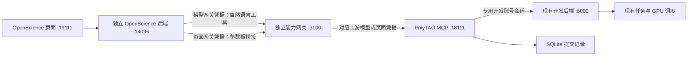

# 聚合物生成 PolyTAO MCP：18111 服务与 19111 能力网关

PolyTAO MCP 通过专用开发会员账号的真实会话调用现有聚合物生成后端，并保存参数草稿与确认记录。模型可用五个工具，页面专用客户端可用四个工具（共享一个读取工具，共八个）；首次生成提交只能由页面确认工具完成。MCP 不加载模型，也不新建 GPU 队列；现有后端负责模型运行、候选过滤与任务状态。

最终入口为 `http://127.0.0.1:19111/`，模型调用和参数板操作都经过独立能力网关 `capability-gateway-dev:3100/mcp`，再调用 PolyTAO MCP `18111`。OpenScience 只注册既有知识库和能力网关两个 MCP 连接，不增加直连 PolyTAO 的连接。完整网关配置、14/4 工具范围和部署验收见 [19111 能力网关接入文档](polytao-capability-gateway-dev.md)。

页面默认使用通用 **Research** 对话，不增加 `Polytao-Generation` 功能模式。可直接输入“我想生成 3 个聚合物候选，不知道需要哪些参数，先让我填写”，由模型调用 MCP 准备参数卡片。卡片用中文显示 15 项描述符、单位、说明和填写来源，支持直接填写或可选的参考 SMILES 计算；高级采样设置已有默认值。保存、计算描述符和刷新均不生成，点击“确认并生成”后才提交。

结果卡片的“查询时间”表示最近一次 `get_polytao_job` 工具返回状态的时间，按浏览器时区显示。它不是新的生成时间，也不表示持续同步后端状态；运行中的任务可在对话中继续查询。任务编号和执行阶段保留在“任务详情”，长编号不会参与摘要列宽计算。页面刷新从已保存的工具结果恢复卡片，不重新提交生成。

本期开发配置保持 `USAGE_ENTITLEMENTS_ENABLED=false`。因此它没有启用生成次数结算，后端也不会仅因收到 `Idempotency-Key` 就为提交去重。适配器使用自己的持久提交记录保护同一请求，不能把它描述成后端原生 exactly-once。

## 功能和工具契约

| 工具 | 客户端 | 用途 |
|---|---|---|
| `get_polytao_capabilities` | 模型 | 可用性、15 项描述符定义、采样参数及限制 |
| `calculate_polytao_descriptors` | 模型 | 从 1–2048 字符的 SMILES 计算完整描述符，返回规范结构 |
| `prepare_polytao_generation` | 模型 | 保存部分或完整描述符、采样设置及可选参考结构，返回待确认卡片；不启动任务 |
| `get_polytao_draft` | 模型、页面 | 读取同一会话内的草稿、版本、缺失字段、填写来源和已接受任务收据 |
| `get_polytao_job` | 模型 | 读取已接受任务的状态、阶段、时间、过滤统计及分页候选 |
| `update_polytao_draft` | 页面 | 按版本保存参数、清除字段或从参考结构重新计算全部描述符 |
| `confirm_polytao_generation` | 页面 | 校验完整参数并冻结版本，提交一次生成，重复确认重放原任务 |
| `cancel_polytao_draft` | 页面 | 取消尚未确认的草稿，不取消已提交的 GPU 任务 |

确认时描述符必须恰好包含 `MolWt`、`HeavyAtomCount`、`NHOHCount`、`NOCount`、`NumAliphaticCarbocycles`、`NumAliphaticHeterocycles`、`NumAliphaticRings`、`NumAromaticCarbocycles`、`NumAromaticHeterocycles`、`NumAromaticRings`、`NumHAcceptors`、`NumHDonors`、`NumHeteroatoms`、`NumRotatableBonds`、`RingCount`。草稿可不完整，空白保持缺失；修改时 `null` 明确清除字段，不会补零。已填写值只允许有限 JSON 数值，拒绝布尔值、数字字符串和额外键。数值范围沿用现有后端，不新增计数非负或整数限制；不接受描述符区间、自由文本性能目标或自动推断缺项。

`prepare_polytao_generation` 和草稿查询的 `conversation_id` 由 OpenScience 执行层覆盖为当前真实 session ID，模型无需知道或填写内部编号。草稿以 `(模型客户端, 账号, 会话, draft_id)` 绑定，`revision` 从 1 开始，每次保存递增；旧版本确认或修改返回冲突。确认冻结当前参数，之后不能编辑。公开裸提交工具 `submit_polytao_generation` 已移除，内部调度器保留既有提交日志保护。

页面只从精确 MCP 工具的结构化输出创建卡片。19111 的模型工具前缀为 `capability_gateway_`；历史 `nexpoly_polytao_` 工具记录仍可展示。其同源 `POST /openscience-api/nexpoly/polytao/draft` 接口校验当前会话确有准备工具产生的草稿，再用独立页面网关凭据，经网关调用 MCP 的读取、修改、确认或取消工具，不直接调用业务生成 REST API。确认成功后，OpenScience 在原会话保存带真实任务收据的 synthetic user message，再继续模型查询；查询失败可通过“继续查询结果”恢复，仍使用同一任务。收据元数据键为 `nexpoly_polytao_receipt`，不随网关前缀变更。浏览器不能伪造这类消息或覆盖已保存的工具记录。

| 参数 | 默认值 | 范围 |
|---|---:|---|
| `candidate_count` | 10 | 整数 1–50 |
| `temperature` | 1.0 | 0.1–2.0 |
| `top_k` | 100 | 整数 1–500 |
| `top_p` | 0.999 | 大于 0、至多 1 |
| `max_length` | 300 | 整数 16–512，生成 token 长度 |

`wait_seconds` 默认为 0，最大 20；查询期间每 2 秒读取后端，单次 MCP 工具硬截止 25 秒。分页 `offset` 默认为 0，`limit` 默认为 10、最大 25。`returned_count` 是整个任务实际候选数量；页大小不会改变它。

生成以描述符为条件进行随机采样。参考 SMILES 仅提供描述符，不保证保留骨架，也没有计算候选与目标的匹配误差。后端过滤 RDKit 可解析结构、至少两个连接点及重复结构。部分结果和零结果可以正常完成；结构可解析不能证明合成可行，SA score 不是合成成功概率，`rank` 是接受顺序。历史字段 `attempts=1` 不表示实际采样次数，`query_time_ms` 不包括排队、首次模型加载或后续 SVG 处理。

工具返回经过 `outputSchema` 校验的 `structuredContent` 及简短文字说明。查询结果只包含 SMILES、可空 SA score、warnings 等公开字段，不返回 SVG、原始解码文本、模型内部 prompt、worker 地址或服务器路径。错误以 `ok:false`、`error.code/message/retryable`、`request_id` 返回，工具执行失败设置 `isError:true`；任务的 `failed` 状态属于正常读取结果。

适配器默认每客户端每分钟最多六十次工具调用、最多两个并发调用，工具截止二十五秒；配置只允许收紧这些限制。后端响应上限 8 MiB，公开工具结果上限 256 KiB，超过上限返回错误，不截断 SMILES。MCP 审计日志仅记录 `client_id`、`request_id`、精确工具名或 `unknown`、状态码、耗时和结果数量，不记录 Cookie、CSRF、Bearer、输入描述符或候选原文；Uvicorn 访问日志关闭。

| 常见错误 | 处理方式 |
|---|---|
| `DRAFT_INCOMPLETE`、`INVALID_ARGUMENT` | 补齐并修正当前草稿，不推测缺项或补零。 |
| `DRAFT_REVISION_CONFLICT` | 重新载入最新参数，核对后再确认。 |
| `DRAFT_NOT_FOUND`、bridge `DRAFT_NOT_IN_SESSION` | 核对当前会话和原草稿，不更换归属绕过检查。 |
| `SESSION_EXPIRED`、`SESSION_UNAVAILABLE` | 运维续期同一专用账号。 |
| `RATE_LIMITED`、`CONCURRENCY_LIMITED` | 等待窗口或并发调用结束。 |
| `SUBMISSION_OUTCOME_UNKNOWN`、`USAGE_OUTCOME_UNKNOWN` | 保留原草稿、提交键与日志核查，不创建替代任务。 |
| `JOURNAL_UNAVAILABLE` | 恢复原持久日志与身份侧文件，禁止初始化空历史。 |
| `JOB_NOT_FOUND` | 核对当前客户端的已接受任务记录；后端重启或淘汰也可能使已接受任务不可读取。 |

## 服务、账号和提交记录



| 资源 | 固定配置 |
|---|---|
| Compose 项目、服务 | `nexpoly_polytao_mcp_dev`、`polytao-mcp` |
| MCP loopback | `http://127.0.0.1:18111/mcp` |
| Gateway 的上游入口 | `http://nexpoly_polytao_mcp_dev-polytao-mcp-1:18111/mcp` |
| OpenScience Compose 项目 | `nexpoly_openscience_dev` |
| 页面、独立 API | `127.0.0.1:19111`、`127.0.0.1:14096` |
| OpenScience 的 Gateway 入口 | `http://capability-gateway-dev:3100/mcp`，不发布宿主端口 |
| 后端目标 | `http://nexpoly_dev-backend-1:8000`，`nexpoly_dev_default` |
| MCP 客户端网络 | `nexpoly_polytao_mcp_clients_dev`，内部网络 |
| 模型客户端身份 | `openscience-polytao-dev`，仅五个模型工具 |
| 页面客户端身份 | `openscience-polytao-dev-ui`，固定映射到上述模型客户端，仅四个页面工具 |
| 私有运行目录 | `.runtime/polytao-mcp`，Git 忽略，目录 `0700`、文件 `0600` |

MCP 加入后端网络，通过四条 PolyTAO API 调用现有服务，并调用认证会话接口核验账号；这不等同于网络层完全隔离数据库。只有 Gateway 加入 PolyTAO 专属客户端网络，OpenScience 后端通过其私有默认网络访问 Gateway，不加入 PolyTAO 客户端或业务后端网络。Gateway 保留原六项业务工具所需的开发后端网络和原筛选客户端网络；OpenScience 的知识库连接保持独立。MCP 不挂载数据库凭据、GPU、模型或业务会话目录。MCP 容器使用调用用户 UID/GID、只读根文件系统，移除 capabilities，绑定 loopback。

`setup` 固定一个已经存在的普通开发会员 UUID，不创建账号或修改会员权益。`login`/`renew-session` 通过 `getpass` 交互读取密码，向已核验开发后端的 loopback `18000` 发送正常登录请求，Host/Origin 均指向实际固定后端 DNS；随后调用 `/api/v1/auth/session` 再核验相同账号、session、CSRF、会员权限和无需改密。密码不保存。请求禁用环境代理和重定向，服务不提供模型可调用的登录工具。

`server/session.json` 保存完整 Cookie 请求头、`session_id`、CSRF token、账号 UUID、固定后端 URL 和到期时间。该目录整体只读挂载，续期通过原子替换文件生效。普通 API 请求带 Cookie 与 `X-Session-Context`，POST 另带匹配实际 Host 的 Origin 和 CSRF。服务调用时再次核验后端会话；12 小时到期或撤销后，需要运维重新登录同一账号。Gateway 与 OpenScience 均不挂载该原生账号会话；OpenScience 仅持有 Gateway Bearer，不继承当前 NexPoly 网页用户身份。

`journal/submissions.sqlite3` 独立可写挂载，持久保存 `(client_id, account_uuid, idempotency_key)`、请求哈希、提交状态、已确认 `job_id` 与有界错误码，不保存生成结果。密钥轮换保持 `client_id`，因此不绕过去重记录。

同一 SQLite 的 `generation_drafts` 表持久保存参数、来源、会话、版本及确认状态；升级通过事务新增表，保留全部既有提交记录。草稿和提交记录均有 10,000 条上限，不自动淘汰。确认使用由 `draft_id + revision` 派生的稳定键，先冻结参数，再按原日志机制提交；双击、同版本重试和重启不会创建替代任务。刷新会从日志恢复已接受收据或不确定状态，不发送新的生成 POST。

`client.env` 为上游模型凭据，`ui-client.env` 为上游页面凭据；19111 的启动器只读验证并复制这两个令牌到自己的私有目录。原生 Cookie、CSRF 与密码不进入 Gateway。注册表中的固定 `owner_client_id` 让页面提交的任务归原模型客户端查询。模型客户端不能获得修改、确认和取消权限，页面客户端不能得到任意模型工具权限。

| 19111 私有文件 | 只读挂载与用途 |
|---|---|
| `gateway-token` | OpenScience `/run/openscience/gateway-token`，模型调用 Gateway 的入口认证 |
| `gateway-ui-token` | OpenScience `/run/openscience/gateway-ui-token` 与 Gateway `/run/capability-gateway/gateway-ui-token`，只供参数板桥接 |
| `polytao-token` | 仅 Gateway `/run/capability-gateway/polytao-token`，上游模型五工具 |
| `polytao-ui-token` | 仅 Gateway `/run/capability-gateway/polytao-ui-token`，上游页面四工具 |

Gateway 每次请求重新认证并固定 audience，不接受 MCP session ID 扩大权限；模型入口提供原有九工具加 PolyTAO 五工具，共十四个，页面入口只提供上述四个草稿工具。Gateway 限定上游 URL、令牌路径、超时与响应大小，不跟随重定向或自动重试提交。上游不可用时原九工具仍可发现。令牌不进入模型提示、工具结果或浏览器。

提交先落盘再发送一次 POST。同键同参数重放接受结果，同键不同参数返回 `IDEMPOTENCY_CONFLICT`。超时、断线、5xx、无效响应和重启后遗留的 `dispatching` 记为 `outcome_unknown`，明确禁止自动补发或更换键重试。同一键保证最多一次 HTTP 提交尝试，不承诺后端 exactly-once。后端当前为有界进程内任务存储，重启或淘汰后可能查不到任务；旧键仍保留提交事实。

记录最多 10,000 条，不自动淘汰。数据库、身份侧文件损坏或丢失时关闭提交和归属查询能力，不自动重建。`setup` 仅在首次固定账号时初始化；重复 setup 会检查既有记录，不能通过删除数据库获得空历史。不要删除整个运行目录来“修复”不确定提交。服务持有单进程锁，停止时保留全部记录。

初次 setup 会先持久保存账号身份，再创建提交记录；如果初始化中断，保留部分文件并明确报错，后续 setup 不会把它当作全新环境。需要运维核查这次未完成的初始化，不能自动清空重试。

## 操作与验证

启动器将运行目录绑定到其脚本所在 checkout，并严格验证现有容器的 Compose 来源及挂载。**提交工作树不会接管已运行的同名项目。** 当前实际部署位置为：

| 部分 | 部署 checkout | 私有运行目录 |
|---|---|---|
| PolyTAO MCP 18111 | `/home/devuser/.codex-desktop-lzq/worktrees/bce3/nexpoly-dev` | 该 checkout 的 `.runtime/polytao-mcp` |
| OpenScience / Gateway 19111 | `/data/lzq/gith/nexpoly-dev` | 该 checkout 的 `.runtime/openscience-mcp-dev` |

维护现有服务时在对应的部署 checkout 执行以下命令；代码从其他 checkout 发布时先审阅并同步受影响源码。不得直接在新工作树执行 setup 来初始化另一个空日志或接管现有容器。下面的首次初始化命令只用于确认为新部署、无既有账号身份和提交历史的环境；当前部署已完成初始化，无需重做。

### MCP 18111

首次部署先固定已有普通开发会员 UUID，密码仅在本机终端隐藏输入中填写：

```bash
python3 scripts/polytao_mcp_dev.py setup --account-uuid <专用开发会员UUID>
python3 scripts/polytao_mcp_dev.py login --username <专用开发用户名>
python3 scripts/polytao_mcp_dev.py up
python3 scripts/polytao_mcp_dev.py status
python3 scripts/polytao_mcp_dev.py smoke
```

现有账号为 `zhiju002`，账号身份保存在私有 `server/identity.json`。不要通过更换账号、删除数据库或重新初始化来处理会话到期、提交不确定或历史任务读取失败。常规操作为：

```bash
python3 scripts/polytao_mcp_dev.py renew-session --username <相同账号用户名>
python3 scripts/polytao_mcp_dev.py smoke
python3 scripts/polytao_mcp_dev.py revoke
python3 scripts/polytao_mcp_dev.py rotate-token
python3 scripts/polytao_mcp_dev.py down
```

这些是各自独立的运维动作，不应作为一组连续执行。续期通过原子替换会话文件生效；撤销下一次请求生效。`rotate-token` 同时更新独立的模型/UI 令牌并保留客户端 ID 与去重记录。令牌轮换后，需要重新 setup 并重建 19111 独立项目，以同步其私有上游令牌副本；仅续期原生账号会话则不需要复制 Cookie 或重建 Gateway。

启动器校验固定开发后端的 Compose 项目、工作目录、配置来源、网络、镜像及认证配置，也校验已有同名 MCP 容器的来源与两处挂载。构建和启动仅控制 MCP 项目，不修改或重启开发后端。原始构建诊断写入私有 `docker-up.log`，不在公共输出打印配置或凭据。`down` 保留账号、会话、令牌、草稿和提交日志。

### OpenScience / Gateway 19111

上游 MCP 与既有只读筛选 MCP 须已运行。首次接入显式指定上述已有 PolyTAO 私有目录；后续从 `polytao-source.json` 复用并重新验证来源：

```bash
python3 scripts/openscience_mcp_dev.py down
python3 scripts/openscience_mcp_dev.py setup \
  --polytao-runtime /home/devuser/.codex-desktop-lzq/worktrees/bce3/nexpoly-dev/.runtime/polytao-mcp
python3 scripts/openscience_mcp_dev.py up
python3 scripts/openscience_mcp_dev.py smoke
python3 scripts/openscience_mcp_dev.py verify-protected
```

该启动器只控制 `nexpoly_openscience_dev`，使用 UI `19111`、API `14096`，不提供专用 PolyTAO profile。它保留默认 Research、知识库、原九工具及计算审批配置。初次 setup 只读提取已核验共享实例的模型和 Agent 配置到独立私有配置，不复制共享会话、业务文件或原生账号会话。模型配置同步及共享保护基线规则见 [OpenScience 开发集成文档](openscience-property-filter-mcp-dev.md)。

先停止 19111，再停止 MCP，避免专属客户端网络仍被 Gateway 使用。升级镜像、令牌或挂载时保留两个项目的原有运行目录与日志。`setup` 不负责迁移另一 checkout 的运行数据；当前运行位置如需变更，必须单独规划可验证的迁移。

`smoke` 只做健康、认证、工具发现和能力读取。MCP smoke 检查模型五工具和页面四工具；19111 smoke 检查 Gateway 模型十四工具、页面四工具、知识库连接和能力查询，不发模型提示、不确认草稿、不创建 GPU 任务。`verify-protected` 核验共享配置和容器指纹，不能通过刷新基线掩盖无关改动。

### 真实验收

真实浏览器探针默认发送一次自然语言需求，经参数板保存、刷新和显式确认，创建一个请求三个候选的真实任务，并校验重复确认、原会话续查与候选卡片。探针仅允许固定的 `19111` 入口。`--check-config` 只静态检查命令行参数并打印入口和运行模式，不启动浏览器、不检查在线配置或凭据、不发送提示或生成任务：

```bash
/home/devuser/.nvm/versions/node/v22.23.2/bin/node \
  scripts/verify_openscience_polytao_gateway_browser.mjs --check-config
# 执行真实浏览器验收，会确认一个新生成任务：
/home/devuser/.nvm/versions/node/v22.23.2/bin/node \
  scripts/verify_openscience_polytao_gateway_browser.mjs
# 对原验收会话只读回查，不再发送提示或确认：
/home/devuser/.nvm/versions/node/v22.23.2/bin/node \
  scripts/verify_openscience_polytao_gateway_browser.mjs \
  --session-url <19111上的会话URL> --marker <原报告的polytao-ui标记>
```

页面证据写入执行 checkout 的 `.runtime/openscience-mcp-dev/polytao-browser-evidence/`，包含原始工具结果、报告及截图。Node 22 与 Playwright/Chromium 已在当前开发机安装；测试和探针支持读取 `/data/lzq/gith/nexpoly-dev/ops/openscience-ui-overlay/node_modules/playwright`，新机器需先安装依赖。

需要单独验证 MCP 时可使用以下命令。第一条会以运维身份使用页面专用 MCP 凭据确认一个新草稿，不替代真实 Research 和参数板验收；第二条只读复核已接受的同一任务：

```bash
python3 scripts/verify_polytao_mcp.py --report-key <本次验收稳定唯一键>
python3 scripts/verify_polytao_mcp.py --report-key <相同键> --job-id <已确认任务编号>
```

报告按 report key 的哈希保存为 MCP 运行目录内的 `acceptance-*.json`，包含代码、源码哈希、镜像 ID、模型来源、参数、任务、时间、过滤统计及结果校验，不含凭据。report key 仅定位报告，提交键由草稿与版本派生；旧参数名 `--idempotency-key` 保留为兼容别名。同一稳定 report key 的私有非阻塞文件锁覆盖标记检查、确认和报告落盘全过程；并发启动立即拒绝，不排队或发送请求。确认前落盘“已尝试”标记，进程中断后恢复或重复同 report key 仍必须提供已确认 `--job-id`，不能新建替代草稿。锁文件保留，不通过删除它强制并发。验收通过原描述符 API 检查 RDKit 解析、至少两个连接点及规范结构去重，接受部分和零候选，不要求固定随机 SMILES。

### 隔离测试

以下测试不需要真实后端账号、模型或 GPU：

```bash
uv venv --python 3.11 .runtime/polytao-mcp/venv
uv pip sync --python .runtime/polytao-mcp/venv/bin/python \
  --require-hashes backend/requirements-polytao-mcp-test.lock
python3 scripts/test_polytao_mcp.py
python3 -m unittest scripts.tests.test_polytao_mcp_dev scripts.tests.test_openscience_mcp_dev \
  scripts.tests.test_verify_polytao_mcp
/home/devuser/.nvm/versions/node/v22.23.2/bin/node --test \
  ops/openscience-mcp-dev/*.test.mjs \
  scripts/tests/verify_openscience_polytao_gateway_browser.test.mjs
```

Gateway 的 `polytao.test.ts` 和 `property-filter.test.ts` 在其锁定的 Bun/MCP SDK 镜像内运行，使用合成 HTTP 上游、临时文件及模拟业务分支，不调用真实 GPU。运行依赖由 `backend/requirements-polytao-mcp.lock` 单独锁定，不包含 PyTorch、RDKit 或 PostgreSQL 驱动；核心测试使用合成 HTTP 后端和临时 SQLite，并通过真实 MCP SDK 验证初始化、工具发现与调用。

`scripts.tests.test_verify_polytao_mcp` 的五项回归覆盖同 report key 并发拒绝、不同 key 隔离、异常后释放以及锁文件权限、符号链接和硬链接边界，不提交真实任务。

## 19111 最终验收（2026-11-16）

已部署的最终链路为 **19111 → 独立 Gateway 3100 → MCP 18111 → 开发后端及既有 GPU 调度**。真实会话为 [Research 聚合物生成验收](http://127.0.0.1:19111/chat/ses_e1c9e0ddbffeOY2VtreK5oh4b4)。

- 自然语言请求未给参考结构或描述符，模型通过 Gateway 查询能力并准备草稿，参数板显示十五项缺失值，确认禁用，未创建任务。
- 页面计算参考结构描述符、清空和恢复单项、保存并刷新，参数及候选数量保持；点击确认后，当前输入先保存，再由页面专用工具冻结版本并提交。
- 双击确认只发一次确认请求；重复原确认 HTTP 请求仍返回同一任务。原会话仅新增一条服务器收据，模型继续查询并返回 **3/3** 个候选。SQLite 的 accepted 总记录从三条增至四条，恰好新增一条。
- 候选完整 SMILES 和 SA 分数与原始工具结果一致；刷新及 320、452、1440px 宽度展示通过。原生 RDKit 接口只读复核三个结构可解析、各有至少两个连接点、规范结构唯一，分数有限。
- Gateway 模型端十四工具、页面端四工具已验证；原九工具完整 Schema 与接入前一致。原三个筛选工具在 19111 再次通过真实自然语言查询，知识库与既有审批配置保持。
- 跨会话草稿操作返回 `403 DRAFT_NOT_IN_SESSION`；模型不能修改、确认或取消草稿，浏览器不能伪造收据与工具记录。共享 9011、原共享 Gateway、知识库和原生后端未重启。

19111 实现验收的 160 项测试包含启动器六十项、OpenScience 六十六项、Gateway 二十八项和真实浏览器脚本六项，全部通过；MCP 核心隔离测试另计。真实报告、截图、工具输出及保护快照留在原部署 checkout 的私有运行目录，不复制到提交工作树，不提交凭据、候选或对话原文：

```text
# 以下相对于 /data/lzq/gith/nexpoly-dev
.runtime/openscience-mcp-dev/polytao-browser-evidence/2026-11-16T08-03-27-512Z/report.json
.runtime/polytao-gateway-integration/20261116T074924Z/acceptance-summary.json
# 原 MCP checkout 的只读结构复核报告
/home/devuser/.codex-desktop-lzq/worktrees/bce3/nexpoly-dev/.runtime/polytao-mcp/acceptance-98716e21e13e8db60e3b.json
```

提交前在整合工作树重新运行全部 OpenScience Node/Playwright 与 Gateway 浏览器脚本测试，七十二项全部通过，无跳过；验收命令的稳定 report key 并发锁另有五项回归。本轮代码复核及隔离回归未新发模型提示或 GPU 任务。

此前的 `19112` 是临时独立验证入口，已验证 MCP 重启后恢复草稿、同版本重放原任务及参数板完整流程。其源码、私有证据与运行服务仍留在原 checkout；本次提交只交付 18111 MCP 和 19111 Gateway 架构，不包含该临时入口的部署 profile 或验收脚本。历史结果不能替代上述 19111 最终验收。

本期不包含 Tg 条件生成、单体正向聚合、批量文件、运行任务取消、结果导出或下游预测/动力学计算，也不提供生产多用户授权和持久任务恢复。单体正向聚合仍由既有独立工具 `polymerize_monomers` 负责，不能代替 PolyTAO 续查。
